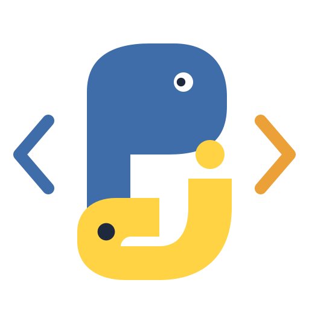

# Pj — Python inside jamovi



Pj is designed to complement **Rj**, which provides an editor for R code in
jamovi, by meeting the corresponding need for a **Python code editor**. It gives
users access to their dataset and displays Python results alongside the analysis,
using either jamovi's embedded Python or a separately installed system Python.

Pj also extends the editor workflow with structured results: Markdown text, HTML,
PNG images, native jamovi tables and styled HTML tables. Dedicated Python
functions — `mzpjShowText`, `mzpjShowHtml`, `mzpjShowImage` and `mzpjShowTable` —
make these result objects available directly from user scripts. They work with
both interpreters without requiring additional Python packages; optional plotting
and data-analysis libraries depend on the selected environment.

The module includes two analyses:

| Analysis | Purpose |
|---|---|
| **Pj Editor** | Write Python code and access dataset columns through the editor. |
| **Pj Editor +** | Select variables explicitly and optionally return newly created columns to the dataset. |

Pjp extends the shared Pj implementation. Both analyses use the same editor,
Python result functions and external service-script support.

## Features

- Python editor with syntax highlighting, completion and error locations.
- Load and save UTF-8 Python scripts; preserve editor drafts in `.omv` documents.
- Combine reusable functions in an external service script with analysis code in the editor.
- Display console output, Markdown text, HTML, PNG images and native jamovi tables.
- Create HTML tables with colors, zebra stripes, transposition, collapsible sections,
  fixed headers and configurable scrolling.
- Use the bundled D3 library with either Python interpreter.
- Display interpreter details and detected libraries without mixing them into the console output.

## Requirements and platform status

Install jamovi **28.3 or newer** and a Pj module build for your operating system. System Python is
optional: jamovi Python is supplied by jamovi itself.

The current source version is **1.0.1**. Development and validation have used
jamovi **28.9.0.0** on Windows, followed by example validation with the
**28.11.0.0** portable installation. The declared minimum version is **28.3**.
On **13 October 2026**, the maintainer confirmed a clean GitHub clone, successful
compilation on **Ubuntu 26.04 LTS**, and loading and verification of **all four
OMV examples from Data Library**. All four examples also passed on Windows.
macOS compilation and desktop use have not yet been verified. Individual
interpreter modes and Flatpak-specific round trips were not enumerated in the
Ubuntu confirmation.

The core result functions do not require pandas or matplotlib. Examples using
these libraries require them in the selected interpreter, normally System Python.
Pj does not install Python packages or modify jamovi's embedded Python installation.
Use **Show Python info** to inspect the active environment; detection of a library
does not guarantee that all of its dependencies can be loaded.

## Installation

In jamovi, open the module library and use its option to install a module from a
local file. Select the `.jmo` built for your platform. The analyses appear under
**Python → Pj**.

Platform packages are published under
[GitHub Releases](https://github.com/MAgojam/Pj/releases). The **1.0.1 patch is
being prepared**, with these intended assets:

- **Windows 64-bit:** `Pj_1.0.1_win64.jmo`.
- **Linux:** `Pj_1.0.1_linux.jmo`.

The `.jmo` files are release assets, not versioned source files.

Version 1.0.1 fixes Pjp Output removal on successful reruns and repairs the saved
BCG editor draft. The maintainer confirmed the corrected True/False workflow
from Data Library on Windows. A new Linux build/validation is pending; the
earlier Ubuntu clean-clone checks apply to 1.0.0. The original v1.0.0 release
assets do not include these corrections. Build from current sources until the
updated platform packages are published.

Sources and documentation are available in the
[Pj repository](https://github.com/MAgojam/Pj). Availability on GitHub does not imply availability from the
public jamovi module library. No macOS release is currently planned or validated.

## First analysis

1. Open **Pj Editor +** and select the dataset variables you want to use.
2. Choose **jamovi Python** or **System Python** in the editor configuration.
3. Enter the following code and click the green Run button.

```python
print('Columns:', list(data))

mzpjShowTable(
    [{'Variable': name, 'Rows': len(values)} for name, values in data.items()],
    columns=['Variable', 'Rows'],
    name='column_overview',
    title='Dataset columns'
)
```

The dataset is supplied as `data`, a dictionary mapping column names to lists.
It is not automatically a pandas DataFrame. Missing values are represented by
`None`; factor labels and textual IDs remain text. An empty dataset supplies
an empty dictionary, so examples that need numeric observations may skip their
summaries or plots.

In **Pjp**, `data` contains only the selected variables, including an ID column
if you select it for labels. Unselected columns are unavailable to the script.
Selecting an ID does not automatically give it a statistical role; the script
decides which numeric columns enter its calculations.

New columns created through Pjp's `data` become Outputs owned by that analysis.
Each successful run replaces its Output set; rerunning without creating those
columns removes its previous Outputs. Original input columns and Outputs from
other analyses remain intact. Clear and failed runs do not request this removal.

In **Pj**, Run transfers all dataset columns by default. To transfer a subset,
start the editor with a first-line comment such as `# (group, before, after)`.
Use the actual column names from your dataset. The directive applies to Pj;
Pjp uses its explicit variable selection instead.

## Python result API

These names are provided by Pj/Pjp during execution; scripts do not import them
from a separate Python package.

| Name | Use |
|---|---|
| `mzpjShowText(content, name=None)` | Display Markdown text. Put headings inside the content. |
| `mzpjShowHtml(content, name=None, title=None)` | Display HTML, including interactive content. |
| `mzpjShowImage(png_data, name=None, title=None)` | Display PNG bytes or a binary buffer. |
| `mzpjShowTable(data, ...)` | Display a native jamovi table or an HTML table. |
| `mzpjFigureSize` | Dictionary containing the figure width and height available to scripts. |
| `mzpjResourcePath(filename)` | Obtain a temporary local path to a bundled module resource. |

`mzpjFigureSize` is a value, not a function. The legacy `show_*` names are not
supported. Explicit result names must begin with an ASCII letter and contain
only ASCII letters, digits and underscores. Reserved names and incompatible
duplicate names are rejected.

For example, this HTML table works without an additional Python library:

```python
mzpjShowTable(
    [
        {'Group': 'Control', 'N': 25, 'Mean': 12.4},
        {'Group': 'Treatment', 'N': 26, 'Mean': 15.3}
    ],
    name='group_summary',
    title='Group summary',
    render='html',
    zebra=(None, '#eef4fa'),
    accordion=True,
    expanded=True,
    max_width=720,
    max_height=320,
    scroll='both',
    sticky_header=True
)
```

Native tables are the default. HTML-only options include colors, zebra stripes,
collapsible containers and viewport dimensions. Row indices in style definitions
start at **0**, counting data rows from the top. The full guide explains style
precedence, accepted colors, annotations, transposition and scroll modes.

PNG images use the figure-size settings. With both fields empty, large images
are fitted within 800 × 600 pixels without enlargement, preserving proportions.
Setting one dimension preserves proportions; setting both uses the requested
display dimensions. If matplotlib is available, ordinary `plt.show()` calls are
captured as jamovi image results.

## Service scripts and editor files

**Browse…** selects a service `.py` file. It runs before the editor code in the
same Python namespace on every execution. Use it for imports, functions and
other reusable definitions. Its imports use the selected interpreter, so an
external script does not make system-only packages available to embedded Python.
Do not rely on Python variables surviving between runs.

**Load script…** reads a `.py` file into the editor without executing it.
**Save script…** exports the current editor contents, independently of the
service file. **Clear** empties the editor and its results while retaining the
selected service file and configuration; the next Run executes them again.

For this workflow, select your reusable helper file with Browse and load your
analysis script into the editor. Imports and functions defined by the helper
file are available directly to the editor code.

To use **two scripts together**, prepare two `.py` files on your computer:

1. `services.py`: imports and tested helper functions. Select it with
   **Service script / Browse…**; it runs behind the scenes.
2. `analysis.py`: calls those helpers and creates the results. Read it into the
   editor with **Load script…**, then edit it there as needed.
3. Select the Python interpreter and click **Run**. Pj executes the service
   first and the editor second, in the same fresh namespace on every run.

For example, save this as `services.py`:

```python
import statistics

def mzpjExampleSummary(values):
    clean = [value for value in values if value is not None]
    if not clean:
        raise ValueError('No non-missing observations are available.')
    return {'N': len(clean), 'Mean': statistics.mean(clean)}
```

Save this as `analysis.py`, replacing `score` with an existing numeric column
transferred to `data` (select it explicitly in Pjp):

```python
summary = mzpjExampleSummary(data['score'])
mzpjShowTable([{'Variable': 'score', **summary}], title='Score summary')
```

Browse does not insert the service code into the editor; Load does not select a
service file. Do not load the active analysis through Browse in this two-file
workflow, and do not import the service by its filename. **Save script…** saves
only the editor code; retain your own source copy of the service file separately.
Both scripts use the same selected interpreter and its installed packages.

**Data Library examples use editor code only**, with Browse left empty, so users
can inspect and modify all example code directly. Separate service/editor
examples can be shared in response to questions on the jamovi forum; they are
not required to run the library documents.

Save the jamovi document as `.omv` to preserve the analysis and editor draft.
When reopening a document containing scripts, jamovi asks whether to enable code
execution. The maintainer has confirmed a Windows save, restart and reopen cycle
with the retained service script and editor code.

## Documentation and examples

After installing the rebuilt module, open **Open → Data Library → Pj** and select
**BCG vaccine - REML and D3 forest plot**. The OMV contains the BCG dataset,
a Pjp analysis with selected variables and an editable Python script already in
the editor. Enable code execution when jamovi asks, then run with jamovi Python
or System Python; this example requires SciPy in the selected interpreter.
It displays native tables, a D3 forest plot with proportional zoom and the
risk-of-bias judgments supplied in the dataset. See the
[BCG example guide](docs/mzPj_bcg_example.md), including the optional calculated
dataset columns. The maintainer has confirmed successful loading and execution
from Data Library on Windows.

**Synthetic participants - pandas and matplotlib** contains a synthetic dataset
and an editable Pj script producing descriptive tables, a grouped boxplot and a
paired scatter plot. It requires **System Python with pandas and matplotlib
installed**. See the [pandas/matplotlib example guide](docs/mzPj_pandas_matplotlib_example.md)
for package requirements and usage. The maintainer has confirmed successful
loading and execution of both examples from Data Library on Windows, including
the BCG forest plot's prediction interval and pooled-effect reference line.

Two further editor-only examples are available:

- **Linear regression - linked D3 diagnostics**: Pjp native OLS tables and
  linked observed/fitted and residual plots; requires NumPy and SciPy in either
  Python interpreter. An optional ID labels points and is not a model predictor.
- **Paired measurements - interactive D3 explorer**: Pj HTML tables, individual
  trajectories, group means and 95% confidence intervals for mean change;
  requires SciPy in either interpreter. Group controls and linked selection
  support exploration while keeping statistical scales and estimates fixed.

See the [interactive examples guide](docs/mzPj_interactive_examples.md) for
settings, assumptions and interactions. The maintainer confirmed successful
loading and execution of all four examples from Data Library on Windows and
Ubuntu 26.04 LTS, including a clean GitHub clone and compilation on Ubuntu
(13 October 2026). All four Data Library
documents contain their complete example code in the editor, with Browse empty.

- [Python results guide](docs/PYTHON_RESULTS_GUIDE.md): detailed function usage, parameters,
  errors, table styling and validation status.
- [Interactive examples guide](docs/mzPj_interactive_examples.md): regression
  diagnostics and paired measurements, including settings and interactions.
- [Maintenance guide](docs/mzPj_maintenance.md): shared services, file responsibilities
  and platform considerations.

Public examples are distributed as OMV documents in `data/`, with their code in
the editors. The development scripts and their catalogue remain local until
they have been reviewed for separate publication.

The approved icon's transparent PNG is included in `inst/extdata`, alongside D3.
The editor embeds the approved SVG directly in its header code.
Use `mzpjResourcePath('mzPj_icon_python.png')` to access the approved icon's PNG during script execution
with either interpreter. The temporary path is removed when execution ends;
it also works when System Python runs on the Flatpak host.

## Executing trusted code

Python scripts execute with the permissions available to the selected interpreter.
Pj does not provide a malware scanner, an execution sandbox, a timeout or a memory
limit. System Python on a Flatpak installation runs on the host when that mode is
available. Enable and run scripts only when you trust their source and contents.

Raw HTML supplied to `mzpjShowHtml` can contain active content. HTML table values
are escaped by the table renderer; this does not make arbitrary Python scripts
or raw HTML safe. The jamovi prompt to enable code execution remains in place.

## Source conventions

Project source files use UTF-8 and LF line endings. Technical code comments are
in Italian. The editable Python scripts stored in public example OMVs use
English comments so users can follow and adapt them. Identifiers, interface labels, result messages and user documentation
are in English. Shared service filenames use the `mzPj_` prefix and underscores;
preserve their exact case on Linux and macOS. Third-party license notices retain
their original wording. Generated R help comments are user documentation and
remain in English.

## Author and license

Author: **Maurizio Agosti**.
Maintainer: **Maurizio Agosti** — <magosti@gmail.com>.

Pj is licensed under **GNU GPL version 2 or later**, as declared in
[`DESCRIPTION`](DESCRIPTION); the GPL version 2 text is included in
[`COPYING`](COPYING), with the choice of later versions granted by that declaration.
Bundled third-party components retain their own notices:
[Brace/Ace license](jamovi/js/node_modules/brace/LICENSE) and
[D3 license](inst/licenses/mzPj_d3_LICENSE.txt).
