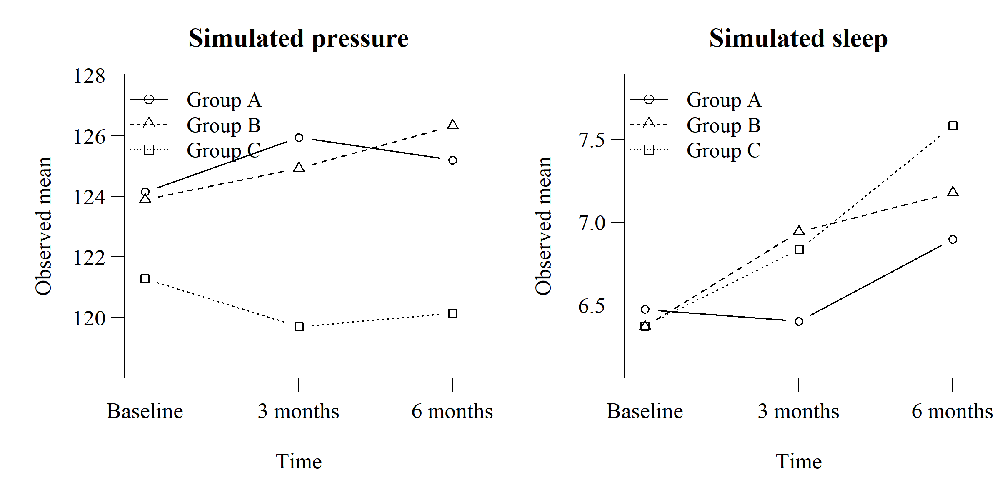

# Python libraries and graphics in Pj

Pj 1.8.0, pj_stats_rust 1.1.0. Edition of 23 November 2026.

A practical guide to libraries, graphic helpers and the statistical backend in Pj and Pjp. Includes reproducible examples and interpretation limits. Requires jamovi 28.18.0 or later.

## 1 Workspace and data

Pj receives the dataset available to its editor; Pjp receives the columns selected in the supplier. In both, data is a dictionary of column lists, not an automatic DataFrame. Keep row positions aligned when combining variables. Dataset missing values are normally None. Use exact column names.

```python
print(list(data))
# The following example needs these two selected input columns.
# pairs = [(a, b) for a, b in zip(data['x'], data['y'])
#          if a is not None and b is not None]
```

Assigning data["new_column"] requests current-dataset Output through the existing Pj mechanism; do not overwrite an input column. Helper-generated analyses, tables and plots enter Results. dataext is a separate, initially empty dataset: Read reads an external OMV and Save writes dataext to the chosen destination. Saving the jamovi document preserves scripts and analyses; saving the external dataset serves a different purpose.

Dataset transformations return copies. Sorting, merging and reshaping long/wide must not independently shift paired variables. The dataset-transformation and dataext guides complement this manual.

## 2 Interpreter and library source

Python interpreter selects Embedded, included with jamovi, or System, installed on the computer. This differs from library source selection. mzpjUseLibrary(..., source="bundled") uses the Pj-supplied copy even with System Python. source="system" uses the selected interpreter’s ordinary imports and does not switch interpreter. Activate libraries before importing them; conflicts with a previously imported copy are reported so the order can be corrected before Run.

```python
mzpjShowTable(mzpjListLibraries(), title='Available libraries')
sp = mzpjUseLibrary('sympy')
# Independent installation, selected before import:
# sp = mzpjUseLibrary('sympy', source='system')
```

The catalog does not import libraries. Available does not certify every feature; Active describes the current execution. SymPy activates mpmath, Jinja2 activates MarkupSafe, and Plotly activates its declared dependencies. The pure Python archive is checksum-verified and prepared in a private cache. The Rust backend is selected by operating system and architecture; binaries are not interchangeable across Windows, Linux and macOS.

NumPy, SciPy, pandas and matplotlib are not part of the Pj bundle. They may exist in Embedded or System Python and should be checked in Python information. The Rust functions described here do not require them.

## 3 Supplied Python libraries

| Import | Version | Supplied dependencies |
| --- | --- | --- |
| sympy | 1.14.0 | mpmath |
| mpmath | 1.3.0 | None |
| jinja2 | 3.1.6 | markupsafe |
| markupsafe | 3.0.3 | None |
| tabulate | 0.10.0 | None |
| uncertainties | 3.2.3 | None |
| simpy | 4.1.1 | None |
| more_itertools | 10.8.0 | None |
| plotly | 7.1.0 | narwhals, packaging |
| narwhals | 2.26.0 | None |
| packaging | 26.3 | None |

### Symbolic mathematics

`sympy` 1.14.0. Exact expressions, differentiation, integration and algebra. Use Rational for exact fractions. Plotting, LaTeX parsing and code generation can require optional components.

```python
sp = mzpjUseLibrary('sympy')
x = sp.Symbol('x')
result = sp.integrate(x**2, (x, 0, 1))
print(result)  # 1/3
```

### High precision numerical mathematics

`mpmath` 1.3.0. The precision context is restored when the block ends. Converting an already rounded Python float to mpf does not recover lost digits; use strings for decimal constants.

```python
mp = mzpjUseLibrary('mpmath')
with mp.workdps(40):
    integral = mp.quad(lambda x: x*x, [0, 1])
    print(mp.nstr(integral, 30))
```

### Templates for reports

`jinja2` 3.1.6. Separate report structure from values. Enable escaping for HTML data; render plain text or pass tabular values to the Pj table helper as appropriate.

```python
jinja = mzpjUseLibrary('jinja2')
env = jinja.Environment(autoescape=True)
text = env.from_string('<p>{{ label }}</p>').render(label='<A>')
print(text)  # <p>&lt;A&gt;</p>
```

### Escaping HTML values

`markupsafe` 3.0.3. MarkupSafe escapes text; it does not validate or statistically process the dataset. Its pure Python fallback is included.

```python
safe = mzpjUseLibrary('markupsafe')
print(safe.escape('<study A & B>'))
```

### Readable text tables

`tabulate` 0.10.0. Useful for console summaries. For native jamovi Results tables use mzpjShowTable; printed text does not become a native table automatically.

```python
tb = mzpjUseLibrary('tabulate')
print(tb.tabulate([['A', 12], ['B', 15]],
                  headers=['Group', 'N'], tablefmt='github'))
```

### Propagation of measurement uncertainty

`uncertainties` 3.2.3. First-order uncertainty propagation preserves dependency when the same uncertain object is reused. This is not a confidence interval or a substitute for sampling inference.

```python
unc = mzpjUseLibrary('uncertainties')
x = unc.ufloat(2.0, 0.1)
y = x*x
print(y.nominal_value, y.std_dev)  # 4.0 0.4
print((x-x).std_dev)  # 0.0
```

### Simulation of processes and queues

`simpy` 4.1.1. Simulation time is determined by the model, not wall-clock time. Queueing examples require explicit arrival/service assumptions and a random seed when randomness is introduced.

```python
simpy = mzpjUseLibrary('simpy')
env = simpy.Environment()
def task():
    yield env.timeout(3)
    print('Completion time', env.now)
env.process(task())
env.run()
```

### Grouping and moving windows

`more_itertools` 10.8.0. Iterators are consumed when read. Preserve subject order deliberately; adjacent windows are not independent observations.

```python
mi = mzpjUseLibrary('more_itertools')
print(list(mi.chunked([1, 2, 3, 4, 5], 2)))
print(list(mi.windowed([1, 2, 3, 4], 3)))
```

### Interactive and exported figures

`plotly` 7.1.0. Pj provides its rendering bridge and JavaScript resources. The static helper creates a native export-oriented result; verify save/export in the target jamovi build. No external browser service is required by this example.

```python
mzpjUseLibrary('plotly')
import plotly.graph_objects as go
fig = go.Figure(go.Bar(x=['A', 'B'], y=[4, 7]))
mzpjShowPlotly(fig, name='manual_plot', static=True,
               title='Illustrative counts')
```

### Choosing the native graphic type

Chart.js, Plotly and D3 share result_type='html'|'svg'|'image'. Html retains
interaction; Svg preserves D3 vectors, while Chart.js and Plotly embed PNG.
Image captures only the figure as a native result. Wait for the final image
before exporting: preparation happens offscreen without temporary messages.
The callback does not rerun Python.

JavaScript-generated Image capture requires Pj/Pjp editors; R API hosts can use
mzpjShowImage with ready PNG bytes. The author accepted the new figures on
Windows and WSL2 with both Python interpreters. Check the intended export format.
static=True keeps the Svg behavior. Chapter 9 covers dimensions, accordions,
size sliders and the new helpers.

```python
mzpjShowChart('bar', [{'data': [2.5, 3.8]}],
              labels=['A', 'B'], result_type='image',
              name='mean_chart', title='Illustrative means')
```

### Dataframe interoperability

`narwhals` 2.26.0. Narwhals adapts supported dataframe implementations; it does not supply pandas, Polars or Arrow. The optional branch is illustrative and runs only when pandas is already installed in the selected interpreter.

```python
nw = mzpjUseLibrary('narwhals')
print(nw.__version__)
# An optional installed backend is required for a real dataframe.
try:
    import pandas as pd
except ImportError:
    print('Optional pandas backend not installed')
else:
    frame = nw.from_native(pd.DataFrame({'x': [1, 2, 3]}))
    print(frame.select(nw.col('x').mean()).to_native())
```

### Versions and software requirements

`packaging` 26.3. Compare parsed versions, not character strings. Source selection can reuse an already loaded compatible packaging module according to the bundle contract.

```python
mzpjUseLibrary('packaging')
from packaging.version import Version
print(Version('1.6.0') > Version('1.5.0'))  # True
print(Version('1.10') > Version('1.9'))  # True
```

## 4 Native statistical function reference

Import the library with import pj_stats_rust as rust and inspect __version__. Function and parameter names are case-sensitive. Historical *_robusta names do not imply sandwich standard errors: ANCOVA and MANCOVA are classical models. Univariate functions require finite numeric values; remove missing observations explicitly while preserving pairs. Correlation matrices and grouped models have the dedicated policies described below.

### calcola somma

```python
rust.calcola_somma(dati)
```

Compensated finite sum; an empty list sums to zero.

### calcola media

```python
rust.calcola_media(dati)
```

Stable arithmetic mean of a nonempty finite list.

### descrittive complete

```python
rust.descrittive_complete(dati)
```

At least two finite values. Sample variance/SD, quartiles, scaled MAD, corrected skewness/kurtosis and a Student 95 percent mean interval. Undefined moments are None.

### quantili

```python
rust.quantili(dati, prob=None)
```

Hyndman–Fan type 7 interpolation; probabilities in [0,1].

### frequenze

```python
rust.frequenze(valori)
```

String categories, trimmed labels, empty labels excluded. Absolute and cumulative percentages.

### correlazione pearson

```python
rust.correlazione_pearson(x, y)
```

At least three finite pairs with positive variance; t test and Fisher 95 percent interval.

### correlazione spearman

```python
rust.correlazione_spearman(x, y)
```

Average exact-tie ranks and an asymptotic t-based p-value, not an exact permutation test.

### matrice correlazione

```python
rust.matrice_correlazione(colonne, metodo=None)
```

Equal-length named columns, pairwise finite observations; pairs with fewer than three complete observations are omitted. Constant valid pairs raise an error.

### ttest campione singolo

```python
rust.ttest_campione_singolo(dati, mu0=None)
```

One-sample t test, default theoretical mean zero, positive sample variance required.

### ttest indipendente

```python
rust.ttest_indipendente(g1, g2, var_uguali=None)
```

Welch by default; var_uguali=True selects pooled Student. Includes a difference interval and pooled Cohen d.

### ttest appaiato

```python
rust.ttest_appaiato(prima, dopo)
```

Equal-length aligned finite pairs; tests first minus second. Positive variance of differences is required.

### mann whitney u

```python
rust.mann_whitney_u(g1, g2)
```

Two-sided asymptotic Mann–Whitney, ties and continuity corrected; u_stat is min(U1,U2), with u1/u2 also returned.

### regressione lineare

```python
rust.regressione_lineare(x, y)
```

Simple OLS with one predictor. At least three aligned finite rows; constant predictors/responses and zero residual variance are rejected for inference.

### anova robusta

```python
rust.anova_robusta(y, gruppi)
```

Fisher, Welch and Kruskal–Wallis rows. Complete rows, at least two groups with two observations each; Welch requires positive within-group variances.

### ancova robusta

```python
rust.ancova_robusta(y, gruppi, covariata)
```

Classical group ANCOVA with one continuous covariate, partial effects and adjusted means at the retained grand covariate mean. No sandwich SE.

### manova robusta

```python
rust.manova_robusta(y_vars, gruppi)
```

Two or more named response columns; joint Pillai, Wilks and Hotelling–Lawley group tests. Nonsingular residual covariance and sufficient residual df required.

### mancova robusta

```python
rust.mancova_robusta(y_vars, gruppi, covariata)
```

Classical multivariate group model adjusted for one continuous covariate. Partial group hypothesis compares reduced and full models.

### bootstrap media

```python
rust.bootstrap_media(dati, n_reps=None, alpha=None, seed=123456789)
```

Mean percentile bootstrap with seed; retains legacy mean result keys.

### bootstrap statistica

```python
rust.bootstrap_statistica(dati, statistica='media', n_reps=10000, alpha=0.05, seed=123456789)
```

Seeded mean or median percentile bootstrap, at least three finite values; 2 to 1000000 replicates and 0<alpha<1.

### correggi p

```python
rust.correggi_p(p_values, metodo='holm')
```

Holm, Bonferroni, BH/fdr, BY or none. Preserve missing positions and use the valid p-value count as default multiplicity.

### contingenza

```python
rust.contingenza(conteggi)
```

Pearson chi-square without Yates, Cramer V, expected counts and Pearson residuals. Asymptotic test; inspect sparse-cell diagnostics.

### statistiche righe

```python
rust.statistiche_righe(colonne, statistica='media', min_validi=1)
```

Batch mean/sum/min/max/sample SD/valid count, preserving row positions. None/NaN omitted per row; infinities rejected.

### rm anova

```python
rust.rm_anova(misure, gruppi=None, livelli=None, missing='listwise')
```

One outcome repeated over ordered conditions, optional between-subject groups. Univariate and multivariate within-subject tests.

### rm ancova

```python
rust.rm_ancova(misure, covariate, gruppi=None, livelli=None, missing='listwise')
```

One repeated outcome adjusted for one or more named time-invariant continuous covariates.

### rm manova

```python
rust.rm_manova(misure, gruppi=None, livelli=None, missing='listwise')
```

Two or more named outcomes, each observed at the same ordered time levels; joint outcome-profile tests and per-outcome diagnostics.

### rm mancova

```python
rust.rm_mancova(misure, covariate, gruppi=None, livelli=None, missing='listwise')
```

Multiple repeated outcomes and one or more subject covariates; full-row listwise deletion shared across outcomes.

For bootstrap, alpha is the probability excluded from the interval: alpha=0.05 produces a 95 percent percentile interval. A seed reproduces results in the same backend version. The limit is one billion sampled values per call. Median bootstrap is more expensive than mean bootstrap and does not produce BCa intervals. Inspect expected contingency counts: an asymptotic p-value does not replace Fisher in sparse tables.

## 5 Worked example from description to result

This example uses declared values and does not change the dataset. It describes the data, tests a paired difference and obtains a bootstrap interval for the mean. These answer different questions: bootstrap of a mean does not replace the test of a paired difference.

```python
import pj_stats_rust as rust
before = [10., 11., 9., 12., 8., 13., 10., 12.]
after  = [11., 11., 11., 14., 9., 13., 12., 15.]
mzpjShowTable([rust.descrittive_complete(before)], title='Before')
mzpjShowTable([rust.ttest_appaiato(before, after)], title='Paired test')
interval = rust.bootstrap_media(before, n_reps=10000, seed=731)
mzpjShowTable([interval], title='Mean bootstrap interval')
```

Before Run, verify that both lists describe the same subjects in the same order. The paired test uses first minus second: a negative estimate means larger average values in the second list. A small p-value does not establish assumptions or clinical importance. The interval uses the measurement unit.

## 6 Repeated measures analysis

### Four models and their data

| Function | Outcomes | Subject-level continuous covariates |
| --- | --- | --- |
| `rm_anova` | One | None |
| `rm_ancova` | One | One or more |
| `rm_manova` | Two or more measured at the same levels | None |
| `rm_mancova` | Two or more measured at the same levels | One or more |

This version supports **one categorical within-subject factor**, such as time
or condition, and an optional **one between-subject grouping factor**. All
subjects share the same ordered levels. Spacing of the levels is not used as a
continuous-time regression predictor. Multiple within-subject factors,
time-varying covariates and group-by-covariate slope interactions are not
implemented. A categorical characteristic belongs in `gruppi`, not in a
continuous covariate slot merely because it has numeric codes.

The design is **wide**: a list of columns, one column for each time level,
with the **same subject in the same position in every column**, group and
covariate. This API does not infer IDs or aggregate duplicated subject rows.
Prepare long data using Pj's [dataset transformations](mzPj_datasets.md) first.

```python
import pj_stats_rust as rust
measurements = [list(data['BP_T0']), list(data['BP_T1']), list(data['BP_T2'])]
covariates = {'age': list(data['age']), 'BMI_baseline': list(data['BMI_0'])}
group = list(data['treatment'])  # strings / category labels, optional
levels = ['Baseline', '3 months', '6 months']
r = rust.rm_ancova(measurements, covariates, gruppi=group, livelli=levels)
mzpjShowTable(r['univariate'], title='RM-ANCOVA')
mzpjShowTable(r['sphericity'], title='Residual sphericity')
```

### Signatures

```python
rust.rm_anova(misure, gruppi=None, livelli=None, missing='listwise')
rust.rm_ancova(misure, covariate, gruppi=None, livelli=None, missing='listwise')
rust.rm_manova(misure, gruppi=None, livelli=None, missing='listwise')
rust.rm_mancova(misure, covariate, gruppi=None, livelli=None, missing='listwise')
```

For the univariate models `misure` is the list of time columns. For the two
multivariate models it is a dictionary of **outcome name → list of time
columns**:

```python
profiles = {
    'Anxiety': [list(data['A_T0']), list(data['A_T1']), list(data['A_T2'])],
    'Sleep': [list(data['S_T0']), list(data['S_T1']), list(data['S_T2'])],
}
r = rust.rm_mancova(profiles, covariates, gruppi=group, livelli=levels)
mzpjShowTable(r['multivariate'], title='Joint profile tests')
```

`covariate` is a dictionary of names and subject-level numeric columns. It
must be nonempty in ANCOVA/MANCOVA. The supplied baseline covariate is constant
within subject; it must not be an exact duplicate of a dependent time column
if that makes the residual covariance or hypothesis degenerate. Covariate
reference means are computed on the **retained subjects**, then centered.

Time-column order is exactly the supplied list order; it is never alphabetically
sorted. Optional `livelli` contains distinct nonempty labels of the same length;
otherwise labels are T1,T2,... . Outcome/covariate names and group levels are
sorted deterministically. Every retained group needs at least two subjects;
a supplied one-level grouping column is rejected (omit it instead).

`None` and NaN identify missing measurements/covariates; `None` or a blank group
label is missing. Infinities are invalid. Default listwise deletion removes the
entire subject if any required value in **any outcome** is missing. Every test
within that report uses the same subject set. `missing='raise'` instead stops
at the first incomplete subject. Excluded rows are not silently compacted into
new correspondences: `included_rows` contains zero-based original positions.
No imputation occurs, and `data`/`dataext` are not modified.

### Hypotheses and results

The full model has an intercept, sum-coded group columns and centered continuous
covariates. Partial **Type III** hypotheses test each term after all the others.
At centered covariates, `Time` tests the **equally weighted mean profile across
group levels**, even when group sizes differ. It is not automatically the
subject-count-weighted population mean. This explicit choice matters with
unbalanced groups. Time-by-group and time-by-each-covariate hypotheses are
reported, together with between-subject effects on time averages. No automatic
between-subject group-by-covariate interaction is added.

Internally, orthonormal time contrasts and rank-checked reorthogonalized QR
projections preserve subject dependence and avoid normal-equation inversion
and subtraction of nearly equal residual SSCP matrices. Heavy numeric work
runs in Rust with Python's interpreter lock released.

Each call returns a dictionary:

| Entry | Meaning |
| --- | --- |
| `n_input`, `n_subjects`, `n_excluded`, `included_rows` | Subject accounting; zero-based retained source rows |
| `levels`, `outcomes`, `groups`, `covariate_reference`, `subject_error_df` | Actual fitted design and covariate centers |
| `univariate` | One row per outcome/effect: F, df, raw p, partial eta squared, GG/HF epsilons and corrected p-values |
| `multivariate` | Joint Pillai, Wilks, Hotelling–Lawley tests for within-subject profiles and between-subject averages |
| `sphericity` | Per-outcome residual Mauchly test with second-order correction and GG/HF epsilons |
| `descriptives` | Raw complete-case group/time means, SD and N; **not adjusted marginal means** |
| `notes`, `ss_type`, `missing`, `model` | Interpretation and method metadata |

The univariate `df1` and `df2` are **uncorrected**. For the GG test multiply both
by `epsilon_GG`; for HF multiply by `epsilon_HF`. F itself is unchanged.
Between-subject rows have no sphericity correction. With two time levels,
epsilons equal1 and Mauchly is not applicable (missing statistic/p, explicit
status). Sphericity diagnostics apply separately to each outcome, not to a
mixture of unrelated measurement units.

Multivariate profile tests are supplied even for the **one-outcome** RM-ANOVA/
ANCOVA: they are a nonsphericity-based alternative within the same design.
With multiple outcomes they jointly test outcome-by-time contrast coordinates.
They need adequate subject residual df and nonsingular residual covariance;
this implementation requires residual df greater than the tested response
contrast dimension. If unavailable, their rows contain `None` and a reason in
`status`; valid univariate tests remain available. Inspect statuses before
interpreting results. This also applies to Mauchly with singular contrasts or
insufficient df. There is no automatic multiplicity correction across outcomes,
effects or alternative statistics; choose the hypothesis in advance and use
`correggi_p` where appropriate.

Models must have positive subject residual df and full-rank between-subject
design. Collinear covariates are rejected rather than silently dropped.
Practical input limits are 256 outcome-time columns, 64 between-subject design
columns and 10 million input measurement values per fit. Classical assumptions
(independent subjects, appropriate residual distributions/covariance and common
between-group covariate slopes) still matter. A successful calculation is not
an assumptions certificate or evidence of causal confounding control.

### Modern alternatives

These APIs implement the requested classical repeated-measures GLM, **not a
linear mixed model**. A Gaussian LMM is a useful next extension for continuous
or subject-specific observation times, time-varying covariates and incomplete
subject trajectories. Its specification needs explicit random effects and
residual covariance. It does not make missing-data assumptions disappear;
likelihood-based handling of incomplete outcomes requires an appropriate
missingness mechanism/model, and missing predictors still require a strategy.
The R [lme](https://stat.ethz.ch/R-manual/R-devel/library/nlme/html/lme.html)
and [lmer](https://lme4.github.io/lme4/reference/lmer.html) contracts distinguish
ML/REML, random effects, covariance structure and missing-row handling.

Proposed future native work: Gaussian random-intercept ML/REML, then random
slopes, covariance diagnostics and prediction; multivariate mixed models later.
These are **not implemented** in native 1.1.0. Test statistics/df approximations
for mixed models require their own validation and are not borrowed from this GLM.


Script 73 is the complete executable lesson: four models, 17 tables and two observed-profile plots on explicitly simulated data. It can run with any open dataset because data is not its input source. For real data replace the lists explicitly; do not compare its simulated results as if they analysed Iris.

### Worked results from script 73

The data are simulated. Lines show observed group means, not individual trajectories or adjusted means. The report uses 44 complete subjects from 45 inputs after a shared exclusion.



| Model | N | Pillai F | df1 | df2 | p |
| --- | --- | --- | --- | --- | --- |
| RM-ANOVA | 44 | 0.841 | 2 | 40 | 0.439 |
| RM-ANCOVA | 44 | 0.802 | 2 | 38 | 0.4558 |
| RM-MANOVA | 44 | 3.753 | 4 | 38 | 0.01141 |
| RM-MANCOVA | 44 | 3.897 | 4 | 36 | 0.009914 |

The table reports the multivariate Time test. Each row tests its own profile and adjustment: comparing p-values across models is not a model-selection procedure. These numbers help check the example, not draw a clinical conclusion.

## 7 Checking results and compatibility

The minimum is jamovi 28.18.0 inclusive. Pj 1.7.0 targets Windows x64, Linux x64, macOS Intel and Apple Silicon. The author accepted visual tests on Windows and Ubuntu 26.04 WSL2 with both Python interpreters. macOS builds and final packages require their own checks; numerical tests do not certify the macOS GUI.

The RM library retains 24 independent R reference designs and 2,405 numerical comparisons. The Rust backend is unchanged. Check the installed module version and selected Python before diagnosing missing functions or dependencies. Library versions follow the supplied catalog rather than automatically tracking upstream releases.

## 8 References and working material

Examples 71, 72 and 73 are in the repository pjscript directory. The complete Pj-helper reference remains in the function handbook; OMV, dataext and transformation guides explain files and external datasets. Library versions shown here come from the supplied catalog and do not promise automatic tracking of every upstream release.

- [R repeated measures GLM](https://stat.ethz.ch/R-manual/R-devel/library/stats/html/anova.mlm.html)
- [R multiple testing](https://stat.ethz.ch/R-manual/R-devel/library/stats/html/p.adjust.html)
- [R mixed models with nlme](https://stat.ethz.ch/R-manual/R-devel/library/nlme/html/lme.html)
- [R mixed models with lme4](https://lme4.github.io/lme4/reference/lmer.html)
- [PyO3 parallelism](https://pyo3.rs/v0.29.0/parallelism)

## 9 Graphics in Pj 1.7.0

Pj includes offline JavaScript engines D3, Plotly and Chart.js. Their Pj helpers
create results without installing their Python packages. Shared mzGraphics
renderers provide the D3 and Plotly presentation; statistical preparation remains
in the Python helper. pj_stats_rust 1.1.0 is unchanged in this release.

### Choose the result and its dimensions

Use result_type='html' for interactive figures, 'svg' for a native vector result,
or 'image' for a native raster result. Native Svg and Image have no Html accordion
or Html zoom controls. Wait for Image capture to finish before exporting.
Direct PNG and SVG helpers can also display existing image data.

Generated figures resolve each dimension in this order: explicit width or height
argument, the corresponding Settings popup value, then 600 by 500 pixels.
Use None or omit an argument to inherit Settings. The whole script runs after Run;
changing a global default does not override a local dimension. Raw Image/Svg
helpers preserve the original aspect ratio if only one local dimension is given;
without local dimensions they use popup values, or the intrinsic image size when
no popup size was supplied. Script 76 demonstrates this separate asset contract.

Html accordions default to accordion=True, expanded=True, accordion_type='line'.
Choose 'bordered' for the alternate heading or accordion=False for no container.
The thin figure-size slider enlarges the complete figure and its reserved area;
it is separate from zooming the statistical axes. Physical Results width can
still require outer horizontal scrolling. Use Reset to restore figure size.
Plotly's modebar is hidden by default; modebar=True displays it and 'hover'
shows it on pointer hover. Static results always omit it. Reset axes restores
the original axis ranges after dragging a rectangle inside an Html Plotly panel.

### Three engines and independent dimensions

The following dataset is invented; no external file is needed. Change Settings
and Run again: only the D3 figure inherits those dimensions. Change the explicit
arguments to resize Plotly and Chart individually. Every call runs on each Run.
An unchanged Html Chart keeps its existing canvas and legend state; data, options
or dimensions affecting that Chart cause the necessary update.

```python
sample = {'Time': [0, 1, 2, 3], 'Score': [12, 15, 14, 19]}
mzpjShowLine(sample, 'Time', 'Score', name='d3_profile',
             title='Observed illustrative scores', result_type='html')
mzpjShowPlotlyLine(sample, 'Time', 'Score', sort_x=True,
                   name='plotly_profile', width=640, height=360)
mzpjShowChart('line', [{'label': 'Score',
    'data': sample['Score']}], labels=sample['Time'],
    name='chart_profile', width=560, height=320)
```

Script 80 is the full dimension-precedence check. For raw Plotly figures use
mzpjShowPlotly with a dictionary containing data/layout or a Python Plotly figure.
Its width argument is preferred; export_width is a compatibility alias and,
when both are supplied, they must agree. Neither installs Python Plotly.

### Five guided Plotly helpers

Scatter supports groups, point labels and hover. Line supports grouped profiles,
explicit sorting and missing-value gaps. Bar supports count, sum, mean and
identity statistics, with grouped, stacked or relative bars. BoxPlot uses linear
quartiles and 1.5-IQR whiskers, with optional observed points; it does not test
group differences. Heatmap displays a numeric matrix with row and column labels.
Script 78 exercises all five with reproducible data. Detailed options and
statistical conventions are in the Plotly helper guide.

```python
sample = {'Group': ['A', 'A', 'B', 'B'],
          'Dose': [1, 2, 1, 2], 'Score': [12, 18, 14, 22]}
mzpjShowPlotlyScatter(sample, 'Dose', 'Score', group='Group',
                      name='scatter', width=640, height=400)
mzpjShowPlotlyBar(sample, 'Group', 'Score', stat='mean',
                  name='means', title='Illustrative group means')
mzpjShowPlotlyBoxPlot(sample, 'Score', group='Group',
                      show_points=True, name='boxes')
mzpjShowPlotlyHeatmap([[1, .4], [.4, 1]],
    x_labels=['A', 'B'], y_labels=['A', 'B'], name='matrix')
```

### A fitted interaction in one call

mzpjShowInteraction fits Y = X + moderator + X by moderator plus optional numeric
additive covariates. It needs NumPy and SciPy in the selected Python. It accepts
independent observations only: repeated unit identifiers are rejected. It is not
a mixed or repeated-measures model and does not imply a causal effect.

```python
# First open pjscript/79_interaction_model.py for a self-contained lesson.
# For your own data, select these exact columns in Pjp, or use Pj.
# report = mzpjShowInteraction(
#     data, x='Dose', y='Score', moderator='Age',
#     covariates=['Baseline'], unit='Participant',
#     covariance='HC3', renderer='plotly', result_type='html',
#     panel_layout='stacked', name='dose_age')
```

The first panel shows fitted mean curves and pointwise confidence intervals at
moderator probes. The second shows the conditional slope and its interval over
the moderator, zero and observed-range Johnson–Neyman crossings. HC3 uses
asymptotic Normal/Wald inference; covariance='OLS' uses residual degrees of
freedom and Student t. Intervals are pointwise, not simultaneous or individual
prediction intervals. Covariates are held at complete-case means; gray observed
points are not covariate-adjusted. The function uses complete cases, reports
exclusions and returns coefficients, covariance, slopes and J–N information.
Two native result tables are included by default (tables=False omits them).

Visible curves checkboxes control each curve, interval band and matching slope
point. Click a colored slope point to highlight its corresponding prediction
curve; Show all curves restores hidden curves and clears highlighting. These
controls do not refit the model or update native tables. A binary moderator is
supported with moderator_type='binary' and an explicit reference category;
there is no continuous J–N region for a binary moderator.

The default stacked layout gives each panel the full figure width; use
panel_layout='side-by-side' when sufficient width is available. Width accepts
400–2400 pixels (720 minimum side by side), height 440–1600. If inherited
Settings are outside those bounds the function reports a validation error.
For a taller stacked lesson use Settings height 800. Explicit local dimensions
override Settings for Html, Svg and Image alike. Script 79 covers both renderers
and all three result types; scripts 75–77 cover containers and native assets.

### Data Library examples and saved analyses

When a script requests a Pj Data Library example, open that example first. Its
saved analyses and Results are already restored. Add a NEW Pj or Pjp analysis
in the SAME open document and load the script there to compare both results.
The library original is protected: saving edits requires a file outside the
Data Library. Scripts 23–30 and later dataset-dependent lessons identify their
required example in their comments; do not invent a local OMV path.


## 10 Hospital Barber–Johnson nomograms

Available in Pj and Pjp from version 1.8.0. No optional Python package is required. This helper describes hospital bed use, not clinical quality, case-mix-adjusted efficiency or future bed requirements.

### Observation and dataset structure

**One row is one ward/facility in one defined observation period.** The pair
`unit` + `period` must be unique. Aggregate source records explicitly before
calling the helper. Use comparable ward types and service definitions. Separate
overnight inpatient activity from day cases. Define whether transfers count as
ward exits and keep that definition consistent with the capacity and bed-days.

The supplied synthetic CSV is `pjscript/data/81_barber_johnson_hospital.csv`:
three wards, four actual calendar quarters in 2025, with a capacity change.
Script `81_barber_johnson.py` also contains those data and runs without a file.
In Pjp select every column named in the call when using the current dataset.
Column arguments map your names: no renaming of the source dataset is required.

| Argument / example column | Meaning and units | Requirements |
| --- | --- | --- |
| `unit='unit'` | Ward or facility identifier | Required, non-missing |
| `period='period'` | Period label, e.g. 2025 Q1 | Required; unique within unit |
| `period_days='period_days'` | Actual period length in days | Required positive numeric column; alternatively a positive scalar applying to every row |
| `beds='beds'` | Mean actually available beds during the period | Positive; used for raw input if available_bed_days is not supplied |
| `available_bed_days=None` | Column with sum of daily available beds, in bed-days | Preferred when capacity changes; positive; replaces beds × days, not an additional quantity |
| `occupied_bed_days='occupied_bed_days'` | Occupied inpatient bed-days in the same period | Raw input; non-negative and no greater than available bed-days |
| `discharges='discharges'` | Completed exits in the same period, including deaths under the chosen definition | Raw input; positive whole counts |
| `order='period_order'` | Numeric chronological position | Required for trajectories; unique within each unit |
| `facet='unit'` | Panel grouping | Optional; defaults to unit; at most 12 panels |
| `group='clinical_area'` | Colour/legend grouping | Optional; defaults to unit; use unit for independently selectable ward trajectories |
| `toi='toi'`, `alos='alos'` | Precomputed TOI and bed-day/discharge ALOS in days | Used with input_mode='toi_alos'; TOI ≥ 0, ALOS > 0 |
| `bor='bor'` | Precomputed occupancy proportion | Used with input_mode='alos_bor'; 0 < BOR ≤ 1, not 0–100 |

`input_mode='raw'` is the default and takes capacity, occupied bed-days and
discharges. It does not silently switch between routes when other columns are
present. `input_mode='toi_alos'` and `'alos_bor'` are explicit alternatives;
their derived identities assume consistent indicator definitions. Mean bed
capacity cannot be recovered from those two indicators alone. For precomputed
input, `size_by_beds=True` requires a real beds column; no capacity is invented.

Rows missing any requested input are excluded and their 1-based row numbers
are returned. Invalid finite values cause an error. Duplicate keys and
inconsistent capacity cause an error. A maximum of 2,000 complete rows is
supported per result. Data and dataext are never modified.

### Formulas and period basis

Let T be period days, C available bed-days, O occupied bed-days, D discharges,
and B = C/T mean available beds. With constant capacity, C = B × T.

| Indicator | Formula | Units |
| --- | --- | --- |
| ALOS used by the nomogram, L | O / D | days |
| Turnover interval, I | (C − O) / D | days |
| Occupancy proportion, p | O / C = L / (L + I) | proportion; displayed as 100p% |
| Observed-period turnover, R | D / B = T / (L + I) | exits per mean bed over T days |
| Turnover on reference period T₀, R₀ | R × T₀/T = T₀ / (L + I) | exits per bed on the selected time basis |

Example: 10 mean beds over 90 days, C=900, O=720 and D=90 give L=8 days,
I=2 days, occupancy=80%, R=9 per quarter and R₀=36.5 per 365 days.
Annualisation rescales a rate; it does not predict future admissions/exits.
The table and point details retain both observed and reference-period turnover.
Use actual days, including leap years. A pooled occupancy is sum(O)/sum(C),
not the unweighted mean of ward percentages; aggregate raw totals deliberately.

**ALOS here is period bed-days divided by period exits.** This can differ from
the mean completed stay of patients discharged in the period because of stays
crossing its boundaries. Do not mix the two definitions and expect the
nomogram identities to hold exactly. TOI is an aggregate capacity indicator,
not a direct measurement of bed cleaning or preparation time.

The graphical reference equations are:

- TOI–ALOS occupancy rays: L = p I / (1 − p).
- TOI–ALOS turnover lines: L = T₀/R₀ − I.
- TOI–BTO occupancy curves: R₀ = T₀(1 − p)/I, for I > 0.
- TOI–BTO constant-ALOS curves: R₀ = T₀/(L + I).

At I=0, a fully occupied observation is plotted using its finite calculated
turnover; the singular reference curve is not evaluated at zero. The helper
does not replace the real period with a fixed 365-day quarter.

### Four presentations

- `view='toi_alos'`: the classic nomogram with occupancy rays and turnover lines.
- `view='toi_bto'`: TOI against reference-period BTO with occupancy and ALOS curves.
- `view='trajectory'`: TOI–ALOS positions joined in explicit numeric order for
  each unit. Arrows indicate sequence, not causality. Missing requested rows
  are excluded; a connection can therefore span a missing period.
- `view='faceted'`: separate, vertically stacked panels by facet, using the
  same limits in all panels. Height is per panel, not total figure height.

### Call and options

```python
report = mzpjShowBarberJohnson(
    data, view='trajectory', input_mode='raw',
    unit='ward', period='quarter', period_days='days',
    available_bed_days='capacity_bed_days',
    occupied_bed_days='occupied_days', discharges='exits',
    order='quarter_order', group='ward', turnover_days=365,
    scenarios=[{'label':'Locally selected range', 'bor':[.75,.85], 'toi':[1,3]},
               {'label':'Comparison threshold', 'bor':.90}],
    width=800, height=400, result_type='html', name='hospital_nomogram')
```

`turnover_days=365` defines the reference time basis. Reference families are
configured with `occupancy_lines` (proportions), `turnover_lines` (BTO on that
basis) and `alos_lines` (days); empty lists hide a family, at most 12 per family.
`max_toi`, `max_alos`, `max_bto` set axis limits, otherwise calculated from data.
Observations outside explicit limits are clipped and counted in the report.
`size_by_beds=False` enables optional square-root-scaled bed-capacity markers
when True; a minimum readable marker radius is retained. `point_labels=False`
avoids clutter; True adds unit or period labels, which can overlap in dense data.
All values remain available on focus/selection without labels.

`scenarios=None` shows no target area by default. Supply up to six dictionaries
with distinct `label`, `bor` as a single threshold or [lower, upper] interval,
and optional `toi`/`alos` bounds in days. Single thresholds draw lines;
intervals draw lightly shaded intersections. BOR bounds must be within (0,1).
References are user-selected scenarios, never automatic efficiency categories.
The legend toggles each ward/group and scenario without recalculating data.
Their values appear in notes; native SVG export also includes legend visibility.

Hover/focus a point for all indicators; click/Enter pins its projection lines,
Escape clears selection. The existing figure-size slider enlarges the figure
and its Results area. Reset restores size and clears selection, retaining legend
visibility. It does not change the axes or the underlying indicators.

`width=None`, `height=None` use popup values, then existing Pj defaults. Explicit
arguments take precedence. In faceted view total plot height is panel height ×
panel count. `result_type` supports html, vector svg and captured image. Native
Svg/Image have no Html accordion/size slider and keep jamovi resizing. Releasing
an Image resize handle updates only that figure's dimensions and raster: it
does not execute Python or restart captures, and preserves the other figures
and the table. Base dimensions remain unchanged across repeated drags. Html uses
`accordion=True`, `expanded=True`, `accordion_type='line'` (or 'bordered').
`tables=True` adds a native indicator table. The returned dictionary contains
indicators, excluded_rows, outside, turnover_days and scenarios.

### Evidence and interpretation

The classic construction is retained while interpretation follows current
capacity-management concerns: available beds must be operationally available,
case mix and service type matter, and an average occupancy hides daily peaks.
OECD 2025 explicitly notes no consensus on one optimal occupancy rate. Do not
turn a familiar 85% reference into a universal clinical standard. Local targets
need their own rationale. The chart alone cannot estimate latent reserve,
staffing adequacy, avoidable bed-days or future bed requirements.

References (dates refer to publication, not necessarily observation years):

1. Barber B, Johnson D. *The Presentation of Acute Hospital In-patient Statistics*.
   Hospital and Health Services Review, 1973. Historical construction; full
   original text not reviewed.
2. Pulgar Perera VA, Paniagua Tejo MT, Sañudo García S. *Barber and Johnson diagram
   and latent reserve as tools to optimise the management of hospital beds*.
   J Healthc Qual Res. 2019;34(3):124–130.
   https://doi.org/10.1016/j.jhqr.2019.02.001 — abstract reviewed; no latent-reserve
   estimator is implemented by this helper.
3. OECD. *Health at a Glance 2025*, Hospital beds and occupancy.
   https://www.oecd.org/content/dam/oecd/en/publications/reports/2025/11/health-at-a-glance-2025_a894f72e/8f9e3f98-en.pdf
4. WHO Europe. *Bed occupancy rate (%), acute care hospitals only*.
   https://gateway.euro.who.int/en/indicators/hfa_542-6210-bed-occupancy-rate-acute-care-hospitals-only/
5. Tamarina FA, Suswojo H, Absor S. *Efficiency of Inpatient Care Services at
   Surabaya Islamic Hospital in 2022–2023 Using the Barber-Johnson Approach*.
   Qanun Medika. 2026;10(1). https://doi.org/10.3651/jqm.v10i01.27393
   Recent local descriptive application, not universal validation of targets.

The Raffaele (2014) port-activity paper was consulted for the
mathematical analogy; port-specific definitions and targets are not transferred
to this hospital helper. All supplied hospital data are synthetic.


#### Dimensions and Linux compatibility

On some Linux installations the native Svg/Image resize handle appears at the lower left and may be unresponsive. Use the function’s `width` and `height`, or global Popup dimensions when those arguments are omitted. Explicit arguments take precedence. Script 81 already supplies dimensions; omit them to test global values. Image resizing preserves other figures and tables without executing Python again.
