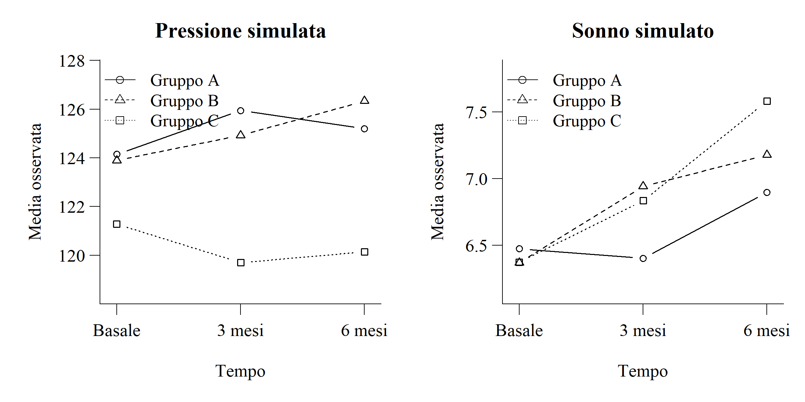

# Librerie Python e grafici in Pj

Pj 1.8.0, pj_stats_rust 1.1.0. Edizione del 23 novembre 2026.

Guida pratica per usare librerie, helper grafici e backend statistico in Pj e Pjp. Include esempi riproducibili e limiti di interpretazione. Richiede jamovi 28.18.0 o successiva.

## 1 Ambiente di lavoro e dati

Pj riceve il dataset disponibile nell’editor; Pjp riceve le variabili selezionate nel supplier. In entrambi, data è un dizionario di liste di colonne, non un DataFrame automatico. Le posizioni delle righe devono restare allineate quando si combinano variabili. I mancanti del dataset sono normalmente None. Usare i nomi esatti delle colonne.

```python
print(list(data))
# The following example needs these two selected input columns.
# pairs = [(a, b) for a, b in zip(data['x'], data['y'])
#          if a is not None and b is not None]
```

Creare data["nuova_colonna"] richiede l’Output verso il dataset corrente secondo il meccanismo Pj già previsto: non sovrascrivere una colonna di input. Le analisi, le tabelle e i grafici prodotti dagli helper finiscono nei Results. dataext è un dataset distinto, inizialmente vuoto: Read legge un OMV esterno e Save salva dataext nella destinazione scelta. Il salvataggio del documento jamovi conserva script e analisi; il salvataggio del dataset esterno ha uno scopo diverso.

Le funzioni di trasformazione restituiscono copie. Ordinamento, merge e passaggio long/wide non devono modificare separatamente le righe di variabili appaiate. La guida delle trasformazioni e quella dataext completano il presente manuale.

## 2 Interprete e sorgente delle librerie

Python interpreter sceglie Embedded, incluso in jamovi, oppure System, installato sul computer. È una scelta diversa dalla sorgente della libreria. mzpjUseLibrary(..., source="bundled") usa la copia distribuita da Pj anche con System Python. source="system" usa le normali importazioni dell’interprete selezionato e non cambia interprete. Attivare le librerie prima di importarle; un conflitto con una copia già importata viene segnalato e richiede di correggere l’ordine e rieseguire lo script.

```python
mzpjShowTable(mzpjListLibraries(), title='Available libraries')
sp = mzpjUseLibrary('sympy')
# Independent installation, selected before import:
# sp = mzpjUseLibrary('sympy', source='system')
```

Il catalogo non importa le librerie. Available non certifica ogni loro funzione; Active descrive l’esecuzione corrente. SymPy attiva mpmath, Jinja2 attiva MarkupSafe, Plotly attiva le dipendenze dichiarate. Il bundle Python puro viene verificato tramite SHA e preparato in una cache privata. Il backend Rust è selezionato per sistema e architettura; i binari non sono intercambiabili tra Windows, Linux e macOS.

NumPy, SciPy, pandas e matplotlib non sono inclusi nel bundle di Pj. Possono essere presenti nell’interprete Embedded o System e vanno verificati nelle informazioni Python. Le funzioni Rust qui descritte non richiedono questi package.

## 3 Librerie Python distribuite

| Import | Versione | Dipendenze fornite |
| --- | --- | --- |
| sympy | 1.14.0 | mpmath |
| mpmath | 1.3.0 | None |
| jinja2 | 3.1.6 | markupsafe |
| markupsafe | 3.0.3 | None |
| tabulate | 0.10.0 | None |
| uncertainties | 3.2.3 | None |
| simpy | 4.1.1 | None |
| more_itertools | 10.8.0 | None |
| plotly | 7.1.0 | narwhals, packaging |
| narwhals | 2.26.0 | None |
| packaging | 26.3 | None |

### Matematica simbolica

`sympy` 1.14.0. Espressioni esatte, derivate, integrali e algebra. Usare Rational per le frazioni esatte. Grafici, parsing LaTeX e generazione di codice possono richiedere componenti opzionali.

```python
sp = mzpjUseLibrary('sympy')
x = sp.Symbol('x')
result = sp.integrate(x**2, (x, 0, 1))
print(result)  # 1/3
```

### Calcolo numerico ad alta precisione

`mpmath` 1.3.0. Il contesto ripristina la precisione precedente alla fine del blocco. Convertire in mpf un float già arrotondato non recupera cifre perse: per costanti decimali usare stringhe.

```python
mp = mzpjUseLibrary('mpmath')
with mp.workdps(40):
    integral = mp.quad(lambda x: x*x, [0, 1])
    print(mp.nstr(integral, 30))
```

### Modelli per i report

`jinja2` 3.1.6. Separare struttura del report e valori. Attivare escaping per i dati HTML; produrre testo oppure passare i valori tabellari al normale helper Pj.

```python
jinja = mzpjUseLibrary('jinja2')
env = jinja.Environment(autoescape=True)
text = env.from_string('<p>{{ label }}</p>').render(label='<A>')
print(text)  # <p>&lt;A&gt;</p>
```

### Escaping dei valori HTML

`markupsafe` 3.0.3. MarkupSafe esegue escaping del testo: non valida né analizza statisticamente il dataset. È incluso il fallback Python puro.

```python
safe = mzpjUseLibrary('markupsafe')
print(safe.escape('<study A & B>'))
```

### Tabelle di testo leggibili

`tabulate` 0.10.0. Utile per riepiloghi in console. Per le tabelle native nei Results usare mzpjShowTable: il testo stampato non diventa automaticamente una tabella nativa.

```python
tb = mzpjUseLibrary('tabulate')
print(tb.tabulate([['A', 12], ['B', 15]],
                  headers=['Group', 'N'], tablefmt='github'))
```

### Propagazione delle incertezze

`uncertainties` 3.2.3. La propagazione al primo ordine conserva la dipendenza se si riutilizza lo stesso oggetto incerto. Non equivale a un intervallo di confidenza né sostituisce l’inferenza campionaria.

```python
unc = mzpjUseLibrary('uncertainties')
x = unc.ufloat(2.0, 0.1)
y = x*x
print(y.nominal_value, y.std_dev)  # 4.0 0.4
print((x-x).std_dev)  # 0.0
```

### Simulazione di processi e code

`simpy` 4.1.1. Il tempo simulato dipende dal modello, non dal tempo dell’orologio. Per le code occorrono ipotesi esplicite su arrivi/servizio e un seed quando si introduce casualità.

```python
simpy = mzpjUseLibrary('simpy')
env = simpy.Environment()
def task():
    yield env.timeout(3)
    print('Completion time', env.now)
env.process(task())
env.run()
```

### Raggruppamenti e finestre mobili

`more_itertools` 10.8.0. Gli iteratori si consumano durante la lettura. Conservare deliberatamente l’ordine dei soggetti: finestre adiacenti non sono osservazioni indipendenti.

```python
mi = mzpjUseLibrary('more_itertools')
print(list(mi.chunked([1, 2, 3, 4, 5], 2)))
print(list(mi.windowed([1, 2, 3, 4], 3)))
```

### Grafici interattivi ed esportabili

`plotly` 7.1.0. Pj fornisce il ponte di rendering e le risorse JavaScript. Il risultato statico è destinato anche all’esportazione nativa: verificare salvataggio/export nella build jamovi in uso. L’esempio non richiede servizi browser esterni.

```python
mzpjUseLibrary('plotly')
import plotly.graph_objects as go
fig = go.Figure(go.Bar(x=['A', 'B'], y=[4, 7]))
mzpjShowPlotly(fig, name='manual_plot', static=True,
               title='Illustrative counts')
```

### Scelta del tipo grafico nativo

Chart.js, Plotly e D3 condividono result_type='html'|'svg'|'image'. Html mantiene
l’interattività; Svg conserva i vettori D3, mentre Chart.js e Plotly incorporano
una PNG. Image acquisisce soltanto la figura come risultato nativo. Attendere
l’immagine finale prima di esportare: la preparazione è fuori dall’area visibile,
senza messaggi temporanei. Il callback non riesegue Python.

L’acquisizione Image generata da JavaScript richiede gli editor Pj/Pjp; gli host
API R possono usare mzpjShowImage con byte PNG già pronti. Le nuove figure sono
state accettate dall’autore su Windows e WSL2 nei due Python. Verificare comunque
il formato di esportazione desiderato. static=True conserva il comportamento Svg.
Vedere il capitolo 9 per dimensioni, accordion, slider e nuovi helper.

```python
mzpjShowChart('bar', [{'data': [2.5, 3.8]}],
              labels=['A', 'B'], result_type='image',
              name='mean_chart', title='Illustrative means')
```

### Interoperabilità tra dataframe

`narwhals` 2.26.0. Narwhals adatta implementazioni dataframe supportate: non fornisce pandas, Polars o Arrow. Il ramo opzionale è dimostrativo e viene eseguito solo se pandas è già installato nell’interprete scelto.

```python
nw = mzpjUseLibrary('narwhals')
print(nw.__version__)
# An optional installed backend is required for a real dataframe.
try:
    import pandas as pd
except ImportError:
    print('Optional pandas backend not installed')
else:
    frame = nw.from_native(pd.DataFrame({'x': [1, 2, 3]}))
    print(frame.select(nw.col('x').mean()).to_native())
```

### Versioni e requisiti software

`packaging` 26.3. Confrontare versioni interpretate, non stringhe di caratteri. La selezione delle sorgenti può riutilizzare un packaging già caricato e compatibile secondo il contratto del bundle.

```python
mzpjUseLibrary('packaging')
from packaging.version import Version
print(Version('1.6.0') > Version('1.5.0'))  # True
print(Version('1.10') > Version('1.9'))  # True
```

## 4 Riferimento delle funzioni statistiche native

La libreria si importa con import pj_stats_rust as rust e riporta __version__. Nomi e argomenti sono sensibili a maiuscole e minuscole. I nomi storici *_robusta non implicano SE sandwich: ANCOVA e MANCOVA sono modelli classici. Le funzioni univariate richiedono valori numerici finiti; rimuovere i mancanti esplicitamente conservando le coppie. Matrici di correlazione e modelli con gruppi hanno politiche dedicate riportate sotto.

### calcola somma

```python
rust.calcola_somma(dati)
```

Somma compensata di valori finiti; la lista vuota restituisce zero.

### calcola media

```python
rust.calcola_media(dati)
```

Media aritmetica stabile di una lista finita non vuota.

### descrittive complete

```python
rust.descrittive_complete(dati)
```

Almeno due valori finiti. Varianza/SD campionarie, quartili, MAD scalata, asimmetria/curtosi corrette e intervallo t al 95 per cento della media. Momenti non definiti: None.

### quantili

```python
rust.quantili(dati, prob=None)
```

Interpolazione Hyndman–Fan tipo 7; probabilità tra 0 e 1.

### frequenze

```python
rust.frequenze(valori)
```

Categorie stringa, etichette ripulite e vuote escluse. Frequenze, percentuali e cumulative.

### correlazione pearson

```python
rust.correlazione_pearson(x, y)
```

Almeno tre coppie finite e varianze positive; test t e intervallo Fisher al 95 per cento.

### correlazione spearman

```python
rust.correlazione_spearman(x, y)
```

Ranghi medi per parimeriti esatti e p asintotico basato su t, non test esatto di permutazione.

### matrice correlazione

```python
rust.matrice_correlazione(colonne, metodo=None)
```

Colonne nominate della stessa lunghezza, osservazioni finite pairwise. Coppie con meno di tre casi completi omesse; coppie valide costanti generano errore.

### ttest campione singolo

```python
rust.ttest_campione_singolo(dati, mu0=None)
```

Test t a un campione, media teorica zero di default; serve varianza campionaria positiva.

### ttest indipendente

```python
rust.ttest_indipendente(g1, g2, var_uguali=None)
```

Welch di default; var_uguali=True seleziona Student pooled. Intervallo della differenza e Cohen d pooled.

### ttest appaiato

```python
rust.ttest_appaiato(prima, dopo)
```

Coppie finite e allineate della stessa lunghezza; differenza prima meno dopo. Serve varianza positiva delle differenze.

### mann whitney u

```python
rust.mann_whitney_u(g1, g2)
```

Mann–Whitney bilaterale asintotico, corretto per parimeriti e continuità. u_stat è min(U1,U2); presenti anche u1/u2.

### regressione lineare

```python
rust.regressione_lineare(x, y)
```

OLS semplice con un predittore. Almeno tre righe finite allineate; predittore/risposta costanti e varianza residua nulla sono rifiutati per l’inferenza.

### anova robusta

```python
rust.anova_robusta(y, gruppi)
```

Righe Fisher, Welch e Kruskal–Wallis. Casi completi, almeno due gruppi con due osservazioni ciascuno; Welch richiede varianze positive nei gruppi.

### ancova robusta

```python
rust.ancova_robusta(y, gruppi, covariata)
```

ANCOVA classica con gruppo e una covariata continua, effetti parziali e medie aggiustate alla media generale inclusa della covariata. Senza SE sandwich.

### manova robusta

```python
rust.manova_robusta(y_vars, gruppi)
```

Due o più colonne risposta nominate; test congiunti del gruppo Pillai, Wilks e Hotelling–Lawley. Servono covarianza residua non singolare e df sufficienti.

### mancova robusta

```python
rust.mancova_robusta(y_vars, gruppi, covariata)
```

Modello multivariato classico del gruppo aggiustato per una covariata continua. Ipotesi parziale del gruppo tramite modelli ridotto e pieno.

### bootstrap media

```python
rust.bootstrap_media(dati, n_reps=None, alpha=None, seed=123456789)
```

Bootstrap percentile della media con seed; conserva le vecchie chiavi dei risultati.

### bootstrap statistica

```python
rust.bootstrap_statistica(dati, statistica='media', n_reps=10000, alpha=0.05, seed=123456789)
```

Bootstrap percentile con seed per media o mediana, almeno tre valori finiti; da 2 a 1000000 repliche e 0<alpha<1.

### correggi p

```python
rust.correggi_p(p_values, metodo='holm')
```

Holm, Bonferroni, BH/fdr, BY o none. Conserva le posizioni mancanti e conta i p validi nella molteplicità di default.

### contingenza

```python
rust.contingenza(conteggi)
```

Chi-quadro Pearson senza Yates, Cramer V, attesi e residui Pearson. Test asintotico: controllare la diagnostica delle celle sparse.

### statistiche righe

```python
rust.statistiche_righe(colonne, statistica='media', min_validi=1)
```

Calcolo per riga di media/somma/min/max/SD campionaria/conteggio, conservando le posizioni. None/NaN omessi per riga, infiniti rifiutati.

### rm anova

```python
rust.rm_anova(misure, gruppi=None, livelli=None, missing='listwise')
```

Una VD ripetuta in condizioni ordinate, gruppi tra soggetti opzionali. Test entro-soggetto univariati e multivariati.

### rm ancova

```python
rust.rm_ancova(misure, covariate, gruppi=None, livelli=None, missing='listwise')
```

Una VD ripetuta aggiustata per una o più covariate continue nominate e fisse nel tempo.

### rm manova

```python
rust.rm_manova(misure, gruppi=None, livelli=None, missing='listwise')
```

Due o più VD nominate agli stessi tempi ordinati; test congiunti dei profili e diagnostica per esito.

### rm mancova

```python
rust.rm_mancova(misure, covariate, gruppi=None, livelli=None, missing='listwise')
```

Più VD ripetute e una o più covariate per soggetto; esclusione listwise condivisa tra tutti gli esiti.

Per il bootstrap, alpha è la probabilità esclusa dall’intervallo: alpha=0.05 produce un intervallo percentile al 95 per cento. Il seed riproduce i risultati nella stessa versione del backend. Il limite è un miliardo di valori ricampionati per chiamata. La mediana è più costosa della media e non produce intervalli BCa. Nei test di contingenza controllare gli attesi: il p-value asintotico non sostituisce Fisher nelle tabelle sparse.

## 5 Esempio guidato dalla descrizione al risultato

L’esempio seguente usa valori dichiarati e non altera il dataset. Prima controlla la distribuzione dei dati, poi valuta una differenza appaiata e infine ottiene un intervallo bootstrap della media. Le tre operazioni rispondono a domande diverse: il bootstrap della media non sostituisce il test sulla differenza appaiata.

```python
import pj_stats_rust as rust
before = [10., 11., 9., 12., 8., 13., 10., 12.]
after  = [11., 11., 11., 14., 9., 13., 12., 15.]
mzpjShowTable([rust.descrittive_complete(before)], title='Before')
mzpjShowTable([rust.ttest_appaiato(before, after)], title='Paired test')
interval = rust.bootstrap_media(before, n_reps=10000, seed=731)
mzpjShowTable([interval], title='Mean bootstrap interval')
```

Controllare prima di Run che le due liste descrivano gli stessi soggetti nello stesso ordine. Il test appaiato usa prima meno dopo: una stima negativa indica valori medi più alti nella seconda lista. Un p piccolo non dimostra validità delle assunzioni o importanza clinica. L’intervallo è espresso nell’unità delle misure.

## 6 Analisi a misure ripetute

### Modelli e disegno supportato

| Funzione | Variabili dipendenti | Covariate continue per soggetto |
| --- | --- | --- |
| `rm_anova` | Una | Nessuna |
| `rm_ancova` | Una | Una o più |
| `rm_manova` | Due o più agli stessi tempi | Nessuna |
| `rm_mancova` | Due o più agli stessi tempi | Una o più |

Questa versione gestisce **un fattore entro-soggetto** (tempo/condizione), un
**eventuale fattore di gruppo tra soggetti**, covariate continue fisse nel tempo.
Le condizioni ordinate sono comuni a tutti i soggetti. Le distanze temporali
non sono usate come regressore continuo. Non sono implementati più fattori
entro-soggetto, covariate variabili nel tempo o interazioni gruppo×covariata.
Una caratteristica categoriale come il genere è un fattore, non una covariata
continua solo perché codificata con numeri.

Dati in formato **wide**: ogni lista è una colonna temporale e ogni posizione
corrisponde allo **stesso soggetto** in tutte le colonne, esiti, gruppi e
covariate. La funzione non ricostruisce gli ID né aggrega righe duplicate.
Per i dati long usare prima le [trasformazioni del dataset](mzPj_datasets_it.md).

```python
import pj_stats_rust as rust
misure = [list(data['PA_T0']), list(data['PA_T1']), list(data['PA_T2'])]
covariate = {'eta': list(data['eta']), 'BMI_basale': list(data['BMI_0'])}
gruppo = list(data['trattamento'])  # etichette stringa; facoltativo
r = rust.rm_ancova(misure, covariate, gruppi=gruppo,
                  livelli=['Basale', '3 mesi', '6 mesi'])
mzpjShowTable(r['univariate'], title='RM-ANCOVA')
mzpjShowTable(r['sphericity'], title='Sfericità residua')
```

### Firme e input

```python
rust.rm_anova(misure, gruppi=None, livelli=None, missing='listwise')
rust.rm_ancova(misure, covariate, gruppi=None, livelli=None, missing='listwise')
rust.rm_manova(misure, gruppi=None, livelli=None, missing='listwise')
rust.rm_mancova(misure, covariate, gruppi=None, livelli=None, missing='listwise')
```

Per RM-ANOVA/ANCOVA `misure` è la lista delle colonne temporali. Per
RM-MANOVA/MANCOVA è un dizionario **nome esito → lista delle colonne temporali**:

```python
profili = {
    'Ansia': [list(data['A_T0']), list(data['A_T1']), list(data['A_T2'])],
    'Sonno': [list(data['S_T0']), list(data['S_T1']), list(data['S_T2'])],
}
r = rust.rm_mancova(profili, covariate, gruppi=gruppo)
mzpjShowTable(r['multivariate'], title='Test congiunti dei profili')
```

`covariate` contiene nomi e colonne numeriche a livello del soggetto; deve
essere non vuoto per ANCOVA/MANCOVA. Le covariate vengono centrate sulla media
dei **soggetti effettivamente inclusi**. Evitare di duplicare esattamente una
VD basale nella covariata se questo rende degenere l'ipotesi o la covarianza
residua. L'ordine dei tempi è quello delle liste: non viene ordinato per nome.
`livelli` deve contenere etichette uniche e non vuote, una per colonna; altrimenti
si usano T1,T2,... . Esiti, covariate e livelli del gruppo sono ordinati in modo
riproducibile. Ogni gruppo incluso deve avere almeno due soggetti. Una colonna
di gruppo con un solo livello viene rifiutata: va omessa se non serve.

`None` e NaN sono mancanti, gli infiniti generano errore. Per il gruppo sono
mancanti `None` e le etichette vuote. Con `missing='listwise'` si esclude tutto
il soggetto se manca un valore richiesto in **qualsiasi esito** o covariata.
Tutti i test del report usano lo stesso insieme di soggetti. Con
`missing='raise'` il primo soggetto incompleto genera errore. `included_rows`
restituisce gli indici originali a base zero; non si spostano separatamente le
colonne e non si imputano valori. `data` e `dataext` non vengono modificati.

### Ipotesi e interpretazione

Modello con intercetta, contrasti a somma zero per i gruppi e covariate centrate.
I test sono **parziali di tipo III**, cioè ogni termine è valutato dopo gli altri.
`Time` valuta il profilo medio con **uguale peso per ogni livello del gruppo**,
alle covariate centrate. Con gruppi sbilanciati non equivale automaticamente
alla media pesata per numerosità. Sono disponibili Time×Group e Time×ciascuna
covariata, oltre agli effetti tra soggetti sulle medie temporali. Non si aggiunge
automaticamente Group×covariata.

Il calcolo usa contrasti temporali ortonormali e proiezioni QR con controllo
del rango e riortogonalizzazione. Non tratta le righe soggetto×tempo come
osservazioni indipendenti, non inverte le equazioni normali e non sottrae due
SSCP quasi uguali. Il lavoro numerico è Rust con rilascio del lock Python.

Ogni funzione restituisce:

| Chiave | Contenuto |
| --- | --- |
| `n_input`, `n_subjects`, `n_excluded`, `included_rows` | Contabilità dei soggetti e indici originali inclusi, a base zero |
| `levels`, `outcomes`, `groups`, `covariate_reference`, `subject_error_df` | Disegno effettivo, centri delle covariate e df residui del soggetto |
| `univariate` | F, df, p non corretto, eta quadrato parziale, epsilon e p GG/HF per esito/effetto |
| `multivariate` | Pillai, Wilks e Hotelling–Lawley congiunti per profili entro-soggetto e medie tra soggetti |
| `sphericity` | Mauchly residuo con correzione di secondo ordine ed epsilon GG/HF per esito |
| `descriptives` | N, media e SD osservate per gruppo/tempo: **non medie marginali aggiustate** |
| `notes`, `ss_type`, `missing`, `model` | Metodo e indicazioni interpretative |

Nelle righe univariate `df1` e `df2` sono **non corretti**: per GG moltiplicarli
entrambi per `epsilon_GG`; per HF per `epsilon_HF`. F non cambia. Gli effetti
tra soggetti non richiedono correzioni di sfericità. Con due tempi epsilon=1 e
Mauchly non è applicabile: statistiche/p mancanti con stato esplicito.
Le correzioni sono per singolo esito, non per una miscela di unità di misura.

Anche RM-ANOVA/ANCOVA con una sola VD restituiscono i test multivariati dei
contrasti temporali: un'alternativa senza assunto di sfericità nel medesimo
disegno. Con più VD si valuta congiuntamente il profilo esito×tempo. Servono
covarianza residua non singolare e sufficienti df residui; qui i df del soggetto
devono superare la dimensione del profilo testato. Se non disponibili, le righe
hanno `None` e una motivazione in `status`; restano i test univariati validi.
Analoga indicazione per Mauchly non calcolabile. Controllare sempre gli stati.
Non si corregge automaticamente la molteplicità tra esiti, effetti e statistiche:
scegliere le ipotesi a priori e usare `correggi_p` quando appropriato.

Servono rango pieno e df residui positivi. Covariate collineari vengono rifiutate,
non eliminate silenziosamente. Limiti operativi:256 colonne esito×tempo, 64
colonne del disegno tra soggetti, 10 milioni di valori per modello. Restano le
assunzioni del GLM classico, indipendenza tra soggetti e pendenze delle covariate
comuni tra gruppi. L'esecuzione riuscita non certifica tali assunzioni né
rimuove automaticamente il confondimento in senso causale.

### Alternative moderne

Queste funzioni implementano il GLM classico richiesto, **non modelli misti**.
Un LMM gaussiano è una possibile estensione per tempi specifici del soggetto,
covariate variabili nel tempo e traiettorie incomplete. Richiede una struttura
esplicita di effetti casuali e covarianza residua. Non elimina le ipotesi sul
meccanismo dei mancanti: likelihood e dati incompleti richiedono un modello
appropriato e i predittori mancanti richiedono comunque una strategia.
Riferimenti: [lme](https://stat.ethz.ch/R-manual/R-devel/library/nlme/html/lme.html)
e [lmer](https://lme4.github.io/lme4/reference/lmer.html).

Possibile sviluppo successivo: LMM gaussiano ML/REML con intercetta casuale,
poi pendenza casuale, diagnostica/predizioni e successivamente modelli misti
multivariati. **Non sono implementati** nella libreria1.1.0; non si riciclano
per essi i df e i test F del GLM attuale.


Lo script 73 fornisce la guida eseguibile completa: quattro modelli, 17 tabelle e due grafici dei profili osservati, su dati simulati esplicitamente dichiarati. Si può eseguire con qualsiasi dataset aperto perché non usa data come sorgente. Per passare ai dati reali sostituire le liste in modo esplicito; non confrontare automaticamente i risultati simulati con Iris.

### Risultati guidati dello script 73

I dati sono simulati. Le linee rappresentano medie osservate di gruppo, non traiettorie individuali né medie aggiustate. Si usano 44 soggetti completi dei 45 iniziali, dopo un’esclusione condivisa.



| Modello | N | F Pillai | df1 | df2 | p |
| --- | --- | --- | --- | --- | --- |
| RM-ANOVA | 44 | 0.841 | 2 | 40 | 0.439 |
| RM-ANCOVA | 44 | 0.802 | 2 | 38 | 0.4558 |
| RM-MANOVA | 44 | 3.753 | 4 | 38 | 0.01141 |
| RM-MANCOVA | 44 | 3.897 | 4 | 36 | 0.009914 |

La tabella riporta il test multivariato di Time. Ogni riga valuta il proprio profilo e aggiustamento: confrontare i p-value tra modelli non costituisce una procedura di selezione del modello. Il valore numerico è una guida al controllo dello script, non una conclusione clinica.

## 7 Verifica dei risultati e compatibilità

Il requisito minimo è jamovi 28.18.0 inclusa. Pj 1.7.0 è destinato a Windows x64, Linux x64, macOS Intel e Apple Silicon. L’autore ha confermato le prove visive su Windows e Ubuntu 26.04 WSL2 nei due Python. Le build macOS e i pacchetti finali richiedono controlli propri; un test numerico non certifica la GUI macOS.

La libreria RM conserva 24 disegni di riferimento R e 2.405 confronti numerici. Il backend Rust non è stato modificato. Controllare la versione del modulo e il Python selezionato prima di diagnosticare funzioni o dipendenze mancanti. Le versioni delle librerie sono quelle del catalogo distribuito, non aggiornamenti automatici upstream.

## 8 Riferimenti e materiali di lavoro

Gli esempi 71, 72 e73 sono nella cartella pjscript del repository. Il riferimento completo degli helper Pj resta nel manuale delle funzioni; le guide OMV, dataext e trasformazioni spiegano i file e i dataset esterni. Le versioni delle librerie riportate qui derivano dal catalogo distribuito e non promettono aggiornamenti automatici a ogni rilascio upstream.

- [R repeated measures GLM](https://stat.ethz.ch/R-manual/R-devel/library/stats/html/anova.mlm.html)
- [R multiple testing](https://stat.ethz.ch/R-manual/R-devel/library/stats/html/p.adjust.html)
- [R mixed models with nlme](https://stat.ethz.ch/R-manual/R-devel/library/nlme/html/lme.html)
- [R mixed models with lme4](https://lme4.github.io/lme4/reference/lmer.html)
- [PyO3 parallelism](https://pyo3.rs/v0.29.0/parallelism)

## 9 Grafici in Pj 1.7.0

Pj include i motori JavaScript offline D3, Plotly e Chart.js. Gli helper Pj
producono risultati senza installare i rispettivi package Python. I renderer
comuni mzGraphics gestiscono la presentazione D3 e Plotly; la preparazione
statistica resta negli helper Python. pj_stats_rust 1.1.0 non cambia in questa versione.

### Tipo di risultato e dimensioni

Usare result_type='html' per grafici interattivi, 'svg' per un risultato nativo
vettoriale e 'image' per un risultato nativo raster. Svg e Image nativi non hanno
accordion o zoom Html. Attendere la fine dell’acquisizione Image prima di
esportare. Gli helper diretti PNG e SVG visualizzano anche immagini esistenti.

Per i grafici generati, ogni dimensione segue questa precedenza: argomento locale
width o height, corrispondente valore della finestra Settings, poi 600 per 500
pixel. Omettere l’argomento o usare None per ereditare Settings. Run riesegue
l’intero script; il default globale non sostituisce un argomento locale.
Gli helper di immagini grezze Image/Svg mantengono le proporzioni originali
quando si passa una sola dimensione locale; senza dimensioni locali usano i
valori della popup, oppure le dimensioni intrinseche se la popup non li imposta.
Lo script 76 illustra questo contratto specifico delle immagini esistenti.

Gli accordion Html usano accordion=True, expanded=True, accordion_type='line'.
Scegliere 'bordered' per il titolo alternativo o accordion=False per ometterli.
Lo slider sottile ingrandisce l’intera figura e lo spazio riservato nei Results;
è distinto dallo zoom sugli assi statistici. La larghezza fisica dei Results può
comunque richiedere scorrimento orizzontale esterno. Reset ripristina le dimensioni.
La barra Plotly è nascosta per default: modebar=True la mostra, 'hover' la mostra
al passaggio del puntatore. I risultati statici la omettono sempre. Reset axes
ripristina gli assi dopo lo zoom rettangolare dentro un pannello Html Plotly.

### Tre motori con dimensioni indipendenti

I dati seguenti sono inventati e non richiedono file esterni. Cambiare Settings
e premere Run: soltanto D3 eredita quelle dimensioni. Modificare gli argomenti
espliciti per ridimensionare Plotly e Chart singolarmente. Tutte le funzioni sono
eseguite a ogni Run. Un Chart Html invariato conserva canvas e stato della
legenda; dati, opzioni o dimensioni che lo riguardano ne richiedono l’aggiornamento.

```python
sample = {'Time': [0, 1, 2, 3], 'Score': [12, 15, 14, 19]}
mzpjShowLine(sample, 'Time', 'Score', name='d3_profile',
             title='Observed illustrative scores', result_type='html')
mzpjShowPlotlyLine(sample, 'Time', 'Score', sort_x=True,
                   name='plotly_profile', width=640, height=360)
mzpjShowChart('line', [{'label': 'Score',
    'data': sample['Score']}], labels=sample['Time'],
    name='chart_profile', width=560, height=320)
```

Lo script 80 completa la prova della precedenza. Per figure Plotly grezze usare
mzpjShowPlotly con un dizionario data/layout o una figura Python Plotly. width è
l’argomento preferito; export_width resta un alias compatibile e, se entrambi
sono passati, devono coincidere. Nessuna chiamata installa Python Plotly.

### Cinque helper Plotly guidati

Scatter offre gruppi, etichette dei punti e hover. Line offre profili per gruppo,
ordinamento esplicito e interruzioni per mancanti. Bar calcola count, sum, mean o
identity, con barre raggruppate, impilate o relative. BoxPlot usa quartili lineari
e baffi a 1,5 IQR, con punti osservati opzionali; non testa differenze tra gruppi.
Heatmap mostra una matrice numerica con etichette di righe e colonne. Lo script
78 prova tutti e cinque con dati riproducibili. La guida Plotly descrive opzioni
e convenzioni statistiche dettagliate.

```python
sample = {'Group': ['A', 'A', 'B', 'B'],
          'Dose': [1, 2, 1, 2], 'Score': [12, 18, 14, 22]}
mzpjShowPlotlyScatter(sample, 'Dose', 'Score', group='Group',
                      name='scatter', width=640, height=400)
mzpjShowPlotlyBar(sample, 'Group', 'Score', stat='mean',
                  name='means', title='Illustrative group means')
mzpjShowPlotlyBoxPlot(sample, 'Score', group='Group',
                      show_points=True, name='boxes')
mzpjShowPlotlyHeatmap([[1, .4], [.4, 1]],
    x_labels=['A', 'B'], y_labels=['A', 'B'], name='matrix')
```

### Un modello di interazione in una chiamata

mzpjShowInteraction stima Y = X + moderatore + X per moderatore con eventuali
covariate numeriche additive. Richiede NumPy e SciPy nel Python selezionato.
Accetta soltanto osservazioni indipendenti: identificativi ripetuti sono rifiutati.
Non è un modello misto o a misure ripetute e non implica causalità.

```python
# Aprire prima pjscript/79_interaction_model.py per una lezione autonoma.
# Per dati propri selezionare queste colonne esatte in Pjp, oppure usare Pj.
# report = mzpjShowInteraction(
#     data, x='Dose', y='Score', moderator='Age',
#     covariates=['Baseline'], unit='Participant',
#     covariance='HC3', renderer='plotly', result_type='html',
#     panel_layout='stacked', name='dose_age')
```

Il primo pannello mostra medie stimate e intervalli puntuali ai valori scelti del
moderatore. Il secondo mostra pendenza condizionale e intervallo lungo il
moderatore, zero e attraversamenti Johnson–Neyman entro il range osservato.
HC3 usa inferenza asintotica Normale/Wald; covariance='OLS' usa gradi di libertà
residui e t di Student. Gli intervalli sono puntuali, non simultanei né di
predizione individuale. Le covariate sono fissate alle medie dei casi completi;
i punti grigi osservati non sono aggiustati. La funzione usa casi completi,
riporta esclusioni e restituisce coefficienti, covarianza, pendenze e informazioni
J–N. Include due tabelle native (tables=False le omette).

Le caselle Visible curves controllano curva, banda e punto di pendenza abbinato.
Un clic sul punto colorato evidenzia la curva corrispondente; Show all curves
ripristina le curve nascoste e cancella l’evidenziazione. Questi controlli non
ristimano il modello né aggiornano le tabelle native. Un moderatore binario è
supportato con moderator_type='binary' e categoria reference esplicita; non ha
una regione J–N continua.

Il layout stacked predefinito offre tutta la larghezza a ciascun pannello;
panel_layout='side-by-side' richiede spazio sufficiente. width accetta 400–2400
pixel (minimo 720 affiancato), height 440–1600. Se i valori ereditati da Settings
sono fuori limite, la funzione segnala un errore. Per una lezione verticale più
alta impostare height 800 nella popup. Le dimensioni locali prevalgono per Html,
Svg e Image. Lo script 79 copre entrambi i renderer e i tre tipi di risultato;
gli script 75–77 illustrano contenitori e immagini native.

### Esempi della Data Library e analisi salvate

Quando uno script richiede un esempio Pj della Data Library, aprirlo prima.
Analisi e Results salvati sono già ripristinati. Aggiungere una NUOVA analisi Pj
o Pjp nello STESSO documento aperto e caricare lì lo script per confrontare i
risultati. L’originale della libreria resta protetto: le modifiche vanno salvate
fuori dalla Data Library. Gli script 23–30 e le lezioni successive dipendenti da
dati identificano l’esempio necessario nei commenti; non inventare percorsi OMV.


## 10 Nomogrammi ospedalieri di Barber–Johnson

Disponibile da Pj 1.8.0, in Pj e Pjp. Non richiede pacchetti Python opzionali. Descrive l’utilizzo dei posti letto ospedalieri, non la qualità clinica, l’efficienza corretta per case-mix o il fabbisogno futuro.

### Struttura del dataset

**Una riga rappresenta un reparto/struttura in un periodo definito.** La coppia
`unit` + `period` deve essere univoca. Aggregare esplicitamente eventuali record
di dettaglio prima della chiamata. Confrontare ambiti assistenziali omogenei;
separare ricovero ordinario e attività diurna. Dichiarare se i trasferimenti
sono conteggiati come uscite del reparto, mantenendo coerenti giornate e capacità.

CSV sintetico: `pjscript/data/81_barber_johnson_hospital.csv`, tre reparti per
quattro trimestri reali del 2025, con variazione della capacità. Lo script
`81_barber_johnson.py` contiene gli stessi dati e funziona anche senza file.
In Pjp selezionare tutte le colonne usate quando si passa il dataset corrente.
Gli argomenti permettono di associare nomi diversi: non occorre rinominare i dati.

| Argomento / colonna dell'esempio | Significato e unità | Requisito |
| --- | --- | --- |
| `unit='unit'` | Identificativo reparto/struttura | Obbligatorio, non mancante |
| `period='period'` | Etichetta del periodo, es. 2025 Q1 | Obbligatoria; univoca nel reparto |
| `period_days='period_days'` | Durata effettiva in giorni | Colonna numerica positiva o costante positiva comune a tutte le righe |
| `beds='beds'` | Posti letto medi effettivamente disponibili | Positivi; usati se non si passa available_bed_days |
| `available_bed_days=None` | Somma giornaliera dei letti disponibili, in giornate-letto | Preferibile se la capacità varia; positiva; sostituisce beds × giorni |
| `occupied_bed_days='occupied_bed_days'` | Giornate di degenza occupate nel periodo | Dati grezzi; non negative, non superiori alle giornate disponibili |
| `discharges='discharges'` | Uscite concluse nel periodo, inclusi decessi secondo la definizione adottata | Dati grezzi; conteggi interi positivi |
| `order='period_order'` | Posizione cronologica numerica | Obbligatoria per traiettorie, univoca nel reparto |
| `facet='unit'` | Raggruppamento dei pannelli | Facoltativo; default reparto, massimo 12 pannelli |
| `group='clinical_area'` | Raggruppamento per colore/legenda | Facoltativo; default reparto; usare unit per selezionare le traiettorie dei singoli reparti |
| `toi='toi'`, `alos='alos'` | TOI e degenza media del nomogramma già calcolati, in giorni | input_mode='toi_alos'; TOI ≥ 0 e ALOS > 0 |
| `bor='bor'` | Occupazione come proporzione | input_mode='alos_bor'; 0 < BOR ≤ 1, non percentuale 0–100 |

`input_mode='raw'` è il default e usa capacità, giornate occupate e uscite.
Non cambia modalità in base alla presenza di altre colonne. Le alternative
esplicite sono `'toi_alos'` e `'alos_bor'`, con indicatori definiti coerentemente.
Da due indicatori non si ricavano i posti letto assoluti: con dati precalcolati,
`size_by_beds=True` richiede una vera colonna beds, senza inventare capacità.

Le righe con input richiesti mancanti vengono escluse e restituite con numero
di riga da 1. Valori finiti non validi, duplicati o capacità incoerenti producono
errore. Massimo 2.000 righe complete per risultato. data e dataext non cambiano.

### Formule e riferimento temporale

T = giorni del periodo; C = giornate-letto disponibili; O = giornate occupate;
D = dimissioni/uscite; B = C/T = letti medi disponibili. A capacità costante,
C = B × T.

| Indicatore | Formula | Unità |
| --- | --- | --- |
| Degenza media del nomogramma, L | O / D | giorni |
| Intervallo di turnover, I | (C − O) / D | giorni |
| Occupazione, p | O / C = L / (L + I) | proporzione, visualizzata come 100p% |
| Rotazione nel periodo, R | D / B = T / (L + I) | uscite per letto medio nei T giorni |
| Rotazione sul riferimento T₀, R₀ | R × T₀/T = T₀ / (L + I) | uscite per letto sulla base temporale scelta |

Esempio: 10 letti medi, 90 giorni, C=900, O=720, D=90: L=8 giorni, I=2 giorni,
occupazione=80%, R=9 nel trimestre e R₀=36,5 su 365 giorni. L'annualizzazione
è un cambio della base di un tasso, non una previsione. Tabella e dettaglio
dei punti conservano sia la rotazione osservata sia quella di riferimento.
Usare la durata effettiva, inclusi anni bisestili. L'occupazione aggregata è
somma(O)/somma(C), non la media semplice delle percentuali dei reparti:
aggregare intenzionalmente i dati grezzi.

**ALOS qui è giornate del periodo / uscite del periodo.** Può differire dalla
durata media individuale dei ricoveri conclusi nello stesso periodo a causa
delle degenze che ne attraversano i confini. Non mescolare definizioni e
aspettarsi identità esatte. Il TOI è un indicatore aggregato della capacità:
non misura direttamente il tempo di pulizia/preparazione del letto.

Equazioni delle linee/curve:

- Raggi di occupazione TOI–ALOS: L = p I / (1 − p).
- Rette di rotazione TOI–ALOS: L = T₀/R₀ − I.
- Curve di occupazione TOI–BTO: R₀ = T₀(1 − p)/I, per I > 0.
- Curve ad ALOS costante TOI–BTO: R₀ = T₀/(L + I).

Per I=0 il punto a occupazione completa mantiene la propria rotazione finita;
la curva singolare non viene calcolata in zero. Il trimestre non viene
trattato impropriamente come un anno di 365 giorni.

### Quattro presentazioni

- `view='toi_alos'`: nomogramma classico con raggi di occupazione e rette di rotazione.
- `view='toi_bto'`: TOI contro BTO sulla base temporale scelta, con curve BOR e ALOS.
- `view='trajectory'`: posizioni TOI–ALOS connesse in ordine numerico esplicito
  per reparto; le frecce indicano sequenza, non causalità. Una connessione può
  attraversare un periodo mancante perché le righe incomplete sono escluse.
- `view='faceted'`: pannelli verticali separati con gli stessi limiti degli assi.
  L'altezza è per pannello, non quella totale della figura.

### Chiamata e personalizzazione

```python
report = mzpjShowBarberJohnson(
    data, view='trajectory', input_mode='raw',
    unit='reparto', period='trimestre', period_days='giorni',
    available_bed_days='giornate_disponibili',
    occupied_bed_days='giornate_occupate', discharges='uscite',
    order='ordine_trimestre', group='reparto', turnover_days=365,
    scenarios=[{'label':'Intervallo scelto localmente', 'bor':[.75,.85], 'toi':[1,3]},
               {'label':'Soglia di confronto', 'bor':.90}],
    width=800, height=400, result_type='html', name='nomogramma_ospedaliero')
```

`turnover_days=365` stabilisce la base di confronto della rotazione. Le famiglie
di riferimenti sono configurabili: `occupancy_lines` (proporzioni),
`turnover_lines` (rotazione sulla base scelta), `alos_lines` (giorni).
Una lista vuota nasconde la famiglia; massimo 12 valori per famiglia.
`max_toi`, `max_alos`, `max_bto` fissano i limiti, altrimenti ricavati dai dati.
I punti esterni sono tagliati e conteggiati nel resoconto.
`size_by_beds=False`: con True la dimensione segue la radice della capacità,
con raggio minimo leggibile. `point_labels=False` evita affollamento;
True aggiunge reparto o periodo, con possibile sovrapposizione nei dati densi.
I valori sono comunque leggibili selezionando i punti.

`scenarios=None`: nessuna area obiettivo predefinita. Fino a sei dizionari con
`label` univoca, `bor` come soglia singola o intervallo [min,max], e limiti
facoltativi `toi`/`alos` in giorni. BOR strettamente tra 0 e 1. La soglia singola
traccia una linea; gli intervalli producono intersezioni leggermente colorate.
Sono riferimenti scelti dall'utente, non categorie automatiche di efficienza.
La legenda mostra/nasconde gruppi e scenari senza ricalcolare i dati. Le note
riportano i valori; l'esportazione Svg riporta anche la visibilità della legenda.

Passaggio del puntatore/focus: lettura dei quattro indicatori. Click/Invio:
selezione fissata con proiezioni; Escape: annullamento. Lo slider condiviso
ingrandisce figura e area Results, senza cambiare assi o indicatori. Reset
ripristina dimensione e selezione, conservando le scelte di visibilità.

`width=None`, `height=None`: valori del popup, poi default Pj. Gli argomenti
espliciti prevalgono. Nei pannelli l'altezza totale è altezza × numero pannelli.
`result_type`: html, svg vettoriale, image catturata. Svg/Image nativi senza
accordion/zoom Html, con ridimensionamento jamovi. Rilasciare il gancio di una
Image aggiorna soltanto le dimensioni e il raster di quella figura: non esegue
Python, non riavvia le catture e conserva le altre figure e la tabella. La
dimensione di base resta invariata anche dopo trascinamenti ripetuti.
Per Html: `accordion=True`,
`expanded=True`, `accordion_type='line'` oppure 'bordered'. `tables=True` aggiunge
la tabella nativa. Restituisce indicators, excluded_rows, outside, turnover_days,
scenarios. Lo script81 dimostra tutte e quattro le viste sullo stesso dataset.

### Letteratura e interpretazione attuale

Conserviamo la costruzione classica e contestualizziamo la lettura: capacità
realmente utilizzabile, tipologia assistenziale, casistica e picchi giornalieri
contano. OECD 2025 esplicita l'assenza di consenso su un'occupazione ottimale
universale. L'85% non diventa automaticamente uno standard clinico generale;
le soglie locali richiedono una motivazione. Dal solo nomogramma non si
stimano riserva latente, adeguatezza del personale, giornate evitabili o
fabbisogno futuro di letti.

Bibliografia (anno di pubblicazione distinto dal periodo dei dati):

1. Barber B, Johnson D. *The Presentation of Acute Hospital In-patient Statistics*.
   Hospital and Health Services Review, 1973. Costruzione storica; testo originale
   integrale non esaminato.
2. Pulgar Perera VA, Paniagua Tejo MT, Sañudo García S. *Barber and Johnson diagram
   and latent reserve as tools to optimise the management of hospital beds*.
   J Healthc Qual Res. 2019;34(3):124–130.
   https://doi.org/10.1016/j.jhqr.2019.02.001 — abstract esaminato; l'helper non
   implementa uno stimatore della riserva latente.
3. OECD. *Health at a Glance 2025*, Hospital beds and occupancy.
   https://www.oecd.org/content/dam/oecd/en/publications/reports/2025/11/health-at-a-glance-2025_a894f72e/8f9e3f98-en.pdf
4. WHO Europe. *Bed occupancy rate (%), acute care hospitals only*.
   https://gateway.euro.who.int/en/indicators/hfa_542-6210-bed-occupancy-rate-acute-care-hospitals-only/
5. Tamarina FA, Suswojo H, Absor S. *Efficiency of Inpatient Care Services at
   Surabaya Islamic Hospital in 2022–2023 Using the Barber-Johnson Approach*.
   Qanun Medika. 2026;10(1). https://doi.org/10.3651/jqm.v10i01.27393
   Applicazione locale descrittiva recente, non validazione di soglie universali.

Il PDF portuale di Raffaele (2014) è supporto all'analogia
matematica: definizioni e soglie portuali non vengono trasferite all'ospedale.
Tutti i dati ospedalieri forniti sono sintetici.

#### Cattura di più immagini e recupero

Se più Image appartengono alla stessa analisi, il bridge invia una PNG per volta e attende la sostituzione del relativo risultato prima di inviare la successiva. Non accumula grandi payload nell'opzione. Passare a Html o rieseguire scarta le catture obsolete; una conferma mancante produce un errore visibile. I contenitori Svg nativi consentono tutta la dimensione scelta con il gancio jamovi, senza ritagli interni.


#### Dimensioni e compatibilità Linux

Su alcune installazioni Linux il gancio nativo Svg/Image è in basso a sinistra e può non rispondere. Usare `width` e `height` della funzione oppure i valori globali del PopUp quando gli argomenti sono omessi. Gli argomenti espliciti prevalgono sul PopUp. Lo script 81 specifica già le dimensioni: ometterle per provare i valori globali. Il ridimensionamento Image conserva le altre figure e tabelle senza rieseguire Python.
